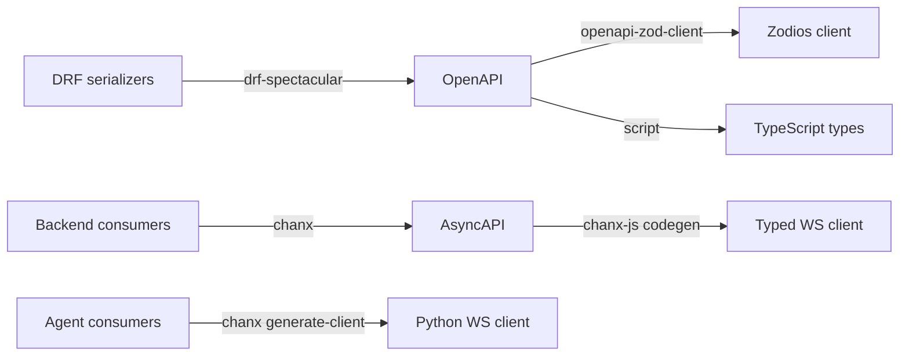
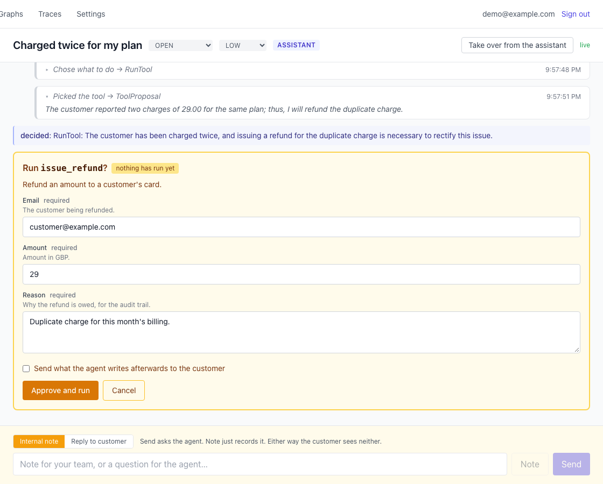

> **TL;DR** Three services in two languages means three seams, and a hand-maintained seam is a slow leak. Declare the shapes once on the server, generate everything else: OpenAPI becomes a typed REST client, AsyncAPI becomes a typed WebSocket client in TypeScript and another in Python. The compiler then tells you what broke instead of a user telling you. The same declarations build the approval form, so a reviewer cannot approve a call whose fields they were never shown.

[Part 2](/posts/agent-graph-engineering/split-the-services/) split the agent off from the business and drew the line at state ownership. That split creates a boundary, and a boundary between two codebases is where systems quietly go wrong. This post is about making it impossible for that boundary to drift.

## Table of contents

## The failure mode, which is not a crash

I have debugged a WebSocket message shape that disagreed between a backend and a frontend, and it cost me most of a day. Not because it is hard to find. Because both sides are _right_.

The backend sends `{ticket_id, content}`. The frontend reads `{ticketId, body}`. Each codebase is internally consistent, each has tests, and each team is certain. Nothing throws. The field is simply `undefined`, which in JavaScript renders as nothing at all, so the symptom is an empty space in the UI where a message should be. You go looking for a bug in rendering, then in the socket, then in the serializer, and the actual defect is that two people wrote down the same idea twice and one of them was six weeks ago.

The REST world mostly solved this a decade ago and we stopped noticing. You write a serializer, a spec falls out, the frontend generates a client, and a renamed field becomes a compile error. Nobody considers that remarkable any more.

The agent layer has no such habit. WebSocket message shapes are still usually a hand-written union on one side and a hand-written type on the other, with a code review as the only thing holding them together. That is a convention, not a contract. Conventions survive exactly as long as the people who remember them.

## Types are the stance, generation is the machinery

Part 1 claimed that the structure of the system should be a declared artifact rather than something you reconstruct by reading code. Contracts are where that claim stops being philosophy.

The order matters, and it is worth being explicit because it is easy to get backwards. **Typing is a design stance you adopt first.** Declare a message as a model. Declare a tool's arguments as a schema. Declare an agent's output as a type. None of that needs a generator, and all of it pays off immediately in one codebase.

**Generation is the machinery you add once a second codebase exists.** Before that it is ceremony. The moment two processes have to agree, it stops being optional, because you have introduced a place where two people's understanding can differ silently.

So: declare on the server, generate everywhere else, and never write the same shape twice.

## Three seams, three generators

The demo application has three services and two languages, which produces three places a shape can cross a boundary.

| Seam                          | Source of truth            | Spec     | Generated artifact                    |
| ----------------------------- | -------------------------- | -------- | ------------------------------------- |
| Browser to backend, REST      | DRF serializers            | OpenAPI  | Zodios client with Zod schemas        |
| Browser to backend, WebSocket | chanx consumers and topics | AsyncAPI | TypeScript client via `chanx-codegen` |
| Backend to agent, WebSocket   | the agent's chanx topics   | AsyncAPI | a Python client the backend imports   |

Drawn out, with the tool that does each step on the arrow:



Every arrow is a generator, and nothing on the right of one is hand-written. One command runs all of it:

```
gen:all = gen:schema && gen:type && gen:ws
```

Which is deliberately boring. The interesting part is what comes out.

## What generation actually preserves

Here is the Python definition of the team's half of a ticket feed. It is the whole thing, and it is mostly a list of what may travel on that channel:

```python
class TicketTeamTopic(Topic[TeamFeedEvent]):
    """Outbound only: the actions a reviewer takes are sent on the ticket's own
    topic, which they are also subscribed to."""

    pattern = "ticket:{ticket_id}:team"
    passthrough_events = [
        NewEventMessage,
        AnswerStreamingMessage,
        AgentProgressMessage,
        ApprovalRequiredMessage,
        ToolProposalMessage,
        ReasoningStreamingMessage,
    ]
```

And here is what the frontend generator produces from it, after the AsyncAPI document in between:

```ts
export type HubTicketTeamTopicToServer = never;
export type HubTicketTeamTopicToClient =
  | AgentProgressMessage
  | AnswerStreamingMessage
  | ApprovalRequiredMessage
  | NewEventMessage
  | ReasoningStreamingMessage
  | ToolProposalMessage;

/** Outbound only: the actions a reviewer takes are sent on the ticket's own
 * topic, which they are also subscribed to. */
ticketTeamTopic: defineTopic<
  HubTicketTeamTopicToServer,
  HubTicketTeamTopicToClient
>()({
  name: 'ticket_team_topic',
  pattern: 'ticket:{ticket_id}:team',
}),
```

Two details in there are worth stopping on.

The first is `ToServer = never`. The Python class says outbound only, by listing no inbound handlers, and that fact survives all the way into the type system of a different language. A frontend developer who tries to send on that topic gets a compile error rather than a message that vanishes into a channel nobody reads. Nobody wrote that rule down twice. It was declared once, as the absence of handlers, and the absence travelled.

The second is the docstring. The sentence explaining _why_ the topic is outbound only is now a JSDoc comment hovering in the editor of whoever is about to use it. I did not expect to care about that and now would not give it up. The reasoning lives next to the code that depends on it, in both languages, without anyone maintaining a second copy of the explanation.

This is also why I keep saying your WebSocket layer deserves what your REST layer already has. It is the same trick. There is no technical reason the channel your agent streams on should be less well specified than the endpoint that lists your tickets.

## The schema can also build the interface

Here is where it stops being about typing and starts being about safety.

The agent can propose a tool call that a human has to approve before it runs. A refund, for instance. The reviewer needs to see the arguments, check them, possibly correct them, and then approve. That is a form.

The naive version is a hand-written form per tool. It works on the day you write it, and then the tool grows a field. The comment on the component that replaced all of them says it better than I will paraphrase it:

```
Hand-written forms are what rot: a field is added server-side, the form is
not updated, and nobody finds out until a request fails or - worse, for the
tool gate - until a reviewer approves a call whose arguments they were never
shown.
```

Read that last clause again, because it is the whole argument. A stale form is not a cosmetic bug in an approval flow. It is a human being asked to authorize something while part of it is hidden from them. The approval is still recorded, the tool still runs with the field the reviewer never saw, and the audit trail says a person checked it.

So the form is generated too. One engine reads a Zod schema and renders fields, validation, and defaults from it. It has two sources feeding it, which is the part I like:

- REST forms get their schema from the OpenAPI generator.
- A tool's arguments arrive over the WebSocket as JSON Schema, at runtime, and are converted to Zod on the way in.

Either way the form, the validation, and the defaults are read off the same object, so a form cannot offer a field the server will reject, and it cannot hide one the server will accept. A tool nobody has built yet already has a working approval UI.

Here is the result, for a refund the agent proposed and a reviewer has not yet approved:



Nobody wrote that form. "The customer being refunded", "Amount in GBP" and "Why the refund is owed, for the audit trail" are the field descriptions off the tool's schema, rendered straight through. Add a field to the tool and it appears here, described, validated, and in front of the person approving it.

That property is only available because the tool's arguments were a declared schema in the first place. It is the compound interest on a decision made two posts ago.

## What it costs

A generated contract is not free, and the costs are the kind that annoy people on a Tuesday.

**It is a build step, and build steps get forgotten.** Change a serializer, forget to regenerate, and you get a type error that points at the generated file rather than at what you actually did. You learn to read it quickly, but the first few are confusing. A pre-commit hook or a CI check is the real answer, and the repo validates the schema separately with `--fail-on-warn` so an ambiguous spec fails before it reaches a generator.

**Generation needs the server running.** The frontend generator fetches the live schema endpoint, so `just gen` starts whatever service it needs first. That is convenient and it is also a dependency, and it means you cannot regenerate on a plane.

**Generated code is ugly and you must not edit it.** Both generated files open with a line telling you not to. Someone will anyway, once.

**You inherit the generator's opinions.** Field naming, optionality, and how a discriminated union maps into the target language are all decisions the tool makes for you. Mostly fine, occasionally not what you would have picked, and essentially never worth fighting.

None of those compare to the afternoon I described at the top.

## When you do not need any of this

One service and one language: skip it. If your types are already shared because everything imports from the same module, a generator adds a step and buys nothing. The whole value is in crossing a process or a language boundary.

A prototype you intend to throw away: also skip it. The cost here is front-loaded and the payoff accrues over months.

A public API with external consumers you cannot recompile: generation still helps you, but it stops being a safety net, because the compiler that catches drift is yours and theirs is not. Versioning becomes the actual problem and that is a different post by a different person.

The sweet spot is exactly the shape in this series: a handful of services, one team, two languages, changing weekly. That is where a generated seam turns a class of silent production bug into a red squiggle.

Next up is the agent and the graph together, which is where the series finally gets into the part everyone came for: a typed model call, and the flow that decides what happens next. Hope this one is useful, particularly the form argument, which I think is underrated.

I write these deep-dives and maintain a handful of Python libraries, so if that is your kind of thing, follow along on [GitHub](https://github.com/huynguyengl99) and [LinkedIn](https://www.linkedin.com/in/huynguyengl99/).
