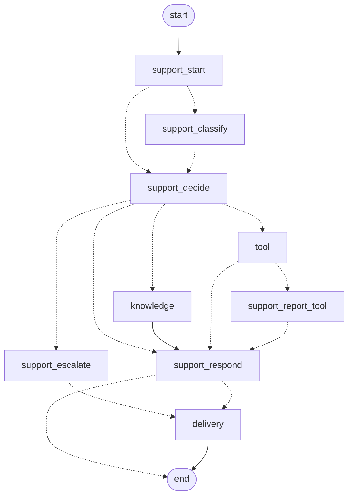

> **TL;DR** An agent is four declarations: a purpose, an output type, its instructions, and the type of its dependencies. A graph node is a function that runs one of those and returns where to go next. The idea that makes them fit together is that **the agent's output type is the routing table.** The model returns one member of a union, the node matches on which member it got, and the transition is a type rather than a parsed string. Both halves are declared, so both halves can be drawn, checked, and changed without reading the whole flow.

The last three posts were architecture. [Part 2](/posts/agent-graph-engineering/split-the-services/) split the services and [Part 3](/posts/agent-graph-engineering/contracts-not-conventions/) made the seams generated. This is the one the series is actually named after.

I am teaching the agent and the graph in a single post on purpose. Most material treats them as separate topics, and I think that is a mistake, because the interesting part is the join: what a model call returns is exactly what the flow needs to decide. Explain them apart and you cover the same ground twice before the idea lands.

## Table of contents

## The thing we are replacing

[Part 0](/posts/agent-graph-engineering/before-it-had-a-name/) told this story at length, so the short version. You classify what the user wants, then you branch:

```python
intent = classify(message)          # returns a string
if intent == "search":
    ...
elif intent == "escalate":
    ...
elif "refund" in message.lower():   # the one somebody added in a hurry
    ...
```

Three problems, in increasing order of how much they will cost you.

The string is unvalidated. The model can return `"searching"`, or `"search_kb"`, or a sentence explaining that it would like to search, and every one of those falls through to your `else`.

The flow is invisible. The only representation of what this system does is the function you are reading. There is no artifact to put in a design review, so the diagram on the wiki is someone's memory of it from two quarters ago.

And nothing can be resumed. Control flow lives on the Python stack, so a process that dies mid-request has lost the request. That rules out pausing for a human, which rules out doing anything irreversible safely.

## An agent is four declarations

Here is the base class every agent in the demo app extends, trimmed to the parts that matter:

```python
class BaseAgent[OutputT]:
    """One step's agent: a purpose, an output shape, and its instructions."""

    purpose: ClassVar[ModelPurpose]
    instructions: ClassVar[str]
    output_type: ClassVar[Any]
    deps_type: ClassVar[Any] = Context

    async def run(
        self, prompt: str, deps: Any, history: list[ModelMessage] | None = None
    ) -> OutputT:
        result = await self.agent.run(prompt, deps=deps, message_history=history)
        self.messages = list(result.all_messages())
        return result.output
```

That is the entire abstraction. `purpose` says which model fills this role, so a cheap model can make routing decisions while an expensive one writes prose. `output_type` is what comes back. `instructions` is the system prompt. `deps_type` is the typed object tools receive instead of reading globals.

One detail in the docstring is load-bearing: agents are **built per run, not at import**. The model filling a purpose is resolved from the user's configuration when the request arrives, so constructing agents at import time would bake in whatever the config said at boot. It also means a test can build one with a scripted model and nothing global needs patching.

A fair question at this point is why there is a class here at all, rather than calling the library's `Agent(...)` behind a factory. A factory alone works, and it is what I had before. The difference is that `purpose` is not a model: a factory resolves purpose to model from the requesting user's config, and the base class is what makes a step unable to name a model even if someone wanted to. With a factory the uniform shape is a convention, and conventions drift, which is the argument in [Part 3](/posts/agent-graph-engineering/contracts-not-conventions/) turned on my own code. The cost is a layer you have to escape when one agent genuinely needs something bespoke. With five near-identical steps it pays; with sixteen heterogeneous ones I would think harder.

Note what `run` returns. Not a string. `OutputT`.

## The output type is the routing table

This is the central idea, and it is small enough to miss.

The agent that decides what to do with a ticket has a union as its output type. Each member is a Pydantic model, and each model is a decision:

```python
class Answer(BaseModel):
    """Answer from what is in front of you, with no lookup.

    Not for anything resting on documented policy, limits, billing rules or a
    published procedure: knowing roughly how it works is not the same as having
    read it, and that is what the knowledge base is for.
    """
    reasoning: str = Field(description="Why no lookup or human is needed.")


class SearchKnowledgeBase(BaseModel):
    """The answer likely exists in the knowledge base."""
    query: str = Field(description="Search terms. Plain words, not a question.")
    reasoning: str = Field(description="What the agent expects to find.")


class RunTool(BaseModel):
    """They are asking for something done, not explained."""
    reasoning: str = Field(description="What they want done.")
```

The model does not return the word `"search"`. It returns a `SearchKnowledgeBase` instance, with a `query` field already filled in and validated. If it had tried to return something that is not one of these shapes, that is a validation error at the boundary, not a mystery three frames later.

Then routing is a match on the type:

```python
def _route_for(
    decision: Decision, for_customer: bool
) -> Literal["knowledge", "tool", "support_escalate", "support_respond"]:
    """Where a decision sends the run."""
    match decision:
        case SearchKnowledgeBase():
            return "knowledge"
        case RunTool():
            return "tool"
        case Escalate() if for_customer:
            return "support_escalate"
        case _:
            # The team is the human it would be escalating to.
            return "support_respond"
```

Compare that to the `if intent == "search"` chain. Same shape, completely different guarantees. Add a member to the union and the type checker finds every match statement that does not handle it. Rename one and the compiler does the rename. There is no string anywhere that two parts of the system have to agree about.

The `Escalate() if for_customer` case is worth noticing too. It encodes a real rule, that escalating to a human is meaningless when the human _is_ the audience, and it encodes it as a guard on a pattern rather than as a condition buried somewhere upstream.

### Where the prompt actually lives

Look at the `Answer` docstring again. It is not documentation for a developer. It is instructions to the model, and it is doing the work a long system prompt would otherwise do:

> Not for anything resting on documented policy, limits, billing rules or a published procedure: knowing roughly how it works is not the same as having read it.

That sentence exists because the model kept confidently answering policy questions from memory instead of searching. The fix was not a longer system prompt. It was putting the guidance on the option it applies to, where the model reads it at exactly the moment it is choosing.

This is my favorite property of typed outputs and it took me a while to see it. The schema is simultaneously the validation, the routing table, and part of the prompt. Three things that would otherwise be three places to keep in sync.

## A node declares where it can go

Now the graph half. Here is the signature of the deciding node:

```python
async def support_decide(
    self, state: SupportState
) -> Command[Literal["knowledge", "tool", "support_escalate", "support_respond"]]:
    """What happens next, and where the run goes to do it."""
```

Read the return type. `Command[Literal[...]]` says: this node returns an update plus a destination, and the destination is one of exactly these four. Not a string. A literal type.

So the legal transitions out of every node are in the type system. A typo is a type error. Adding a destination without declaring it is a type error. And the complete set of edges can be read off the signatures without running anything, which is how the graph renders itself as a diagram that cannot go stale.

Put every node's signature together and you have the whole flow, which is why the graph can draw itself. This is not a diagram I made for the post. It is what `mermaid("support")` emits from the code that runs:



Dotted edges are conditional, solid ones are fixed. `knowledge`, `tool` and `delivery` are subgraphs, drawn here as single boxes; the export can expand them inline instead. The point is that nobody drew this, so it cannot disagree with the code.

The body of the deciding node is unremarkable, which is the point:

```python
decision = await self.run_aloud("decide", self.deciders[context.audience], prompt, context, ...)

update: Update = {"decision": decision}
if isinstance(decision, SearchKnowledgeBase):
    # The handoff into the subgraph: it searches for what the decider
    # asked for, not for the whole ticket.
    update["kb_query"] = decision.query
elif isinstance(decision, RunTool):
    update["request"] = state.question or context.render(with_history=True)
return Command(update=update, goto=_route_for(decision, context.for_customer))
```

Run an agent, write what it decided into state, go where the decision says. The node has no idea what `knowledge` does. It just names it.

Worth being precise about the division there, because it is easy to read the snippet and ask why the routing does not use the decision's fields. **The type picks the destination; the fields ride along in the state update.** `SearchKnowledgeBase.query` is read and written into state, and the route is chosen purely by which member came back. That is deliberate: `_route_for` returns `Literal["knowledge", "tool", "support_escalate", "support_respond"]`, so the type checker proves every branch lands on a node that exists. Branch on a field value instead and you are back to routing on data, with nothing checking you covered the cases.

The other honest note: `goto` takes a node name, so a string does appear at the very end. The library's API requires it. What changed is that the string is produced by an exhaustive match on a type rather than compared against one, and the `Literal` return means a typo is a type error rather than a run that silently goes nowhere.

`_route_for` is a separate function for one practical reason: it can be called in a test without running the graph, which three of them do.

That comment about the handoff is a small design decision with real consequences. The knowledge subgraph receives `decision.query`, the search terms the deciding model chose, rather than the whole ticket. The decider has already read the ticket and formed a view about what to look for, and throwing that away to re-derive it downstream both costs a model call and loses information.

## State is declared too

The thing travelling between nodes is a typed model, not a dict:

```python
class SupportState(BaseState, Knowledge, Tools, Delivery):
    """One message worked, whoever it is from and whoever the answer is for."""

    question: str = ""
    classification: Classification | None = None
    decision: Decision | None = None
    answer: TicketAnswer | None = None

    messages_json: Annotated[str, remembered] = ""
```

Two things here that I would not have designed on the first attempt.

The audience is not a field. It lives on the context, and the branches that only apply to a customer read it. The alternative, which I did try, is two graphs: one for customers and one for the team. They diverged, then they diverged differently, and the shared parts had to be fixed twice. One graph with an audience on the context is smaller and the differences are visible as guards rather than hidden as duplication.

And `messages_json` is a string rather than a list of message objects, with a comment explaining why: the serializer that persists graph state allows types by name, and a type it does not know comes back as nothing. Storing the model's own message history as an opaque blob means it survives a checkpoint round-trip intact. That is a concession to persistence, and persistence is post 6.

The `Annotated[str, remembered]` is a reducer, which is how you say what happens when two updates write the same channel. Most fields just overwrite. A few need to accumulate or to keep what was already there. That mechanism is the thing that most repays reading the docs properly.

## What it costs

The honest version, because [Part 1](/posts/agent-graph-engineering/the-stack-and-why-each-piece-is-there/) promised it. A list of costs with nothing to weigh them against is not much use, so here are the three shapes side by side:

| | `if/else` | a loop | a declared graph |
| --- | --- | --- | --- |
| Lines for the same behavior | fewest | few | most |
| Can be drawn from the code | no | no | yes, exported from the compiled object |
| Pause for a person, resume later | build it yourself | build it yourself | falls out of checkpointing |
| Per-step trace | whatever you log | whatever you log | a span per node, free |
| Test one decision | needs the surrounding call path | needs the surrounding call path | call the node with a state you invented |
| Adding a branch | another condition in an existing chain | another condition in an existing chain | a node and an edge |
| Cost of being wrong early | cheap to change | cheap to change | a state redesign, not a patch |

The row that decides it is usually not line count. It is whether you ever need to answer "what did this run actually do", from a trace or a diagram, after the fact.


**You write more code for the same behavior.** The `if/else` version of the routing above is shorter. It stays shorter right up until the first time you need to pause, resume, trace, or draw it.

**Your first state design will be wrong.** Mine was. You will discover that two nodes want to write the same field for different reasons, which is a reducer you did not know you needed, and the fix is a small rewrite rather than a patch.

**`Command` versus conditional edges is a real fork in the road.** Returning `Command` from the node puts the routing next to the decision, which I prefer. Conditional edges put it in the graph definition, which keeps nodes ignorant of topology. There is one case where you do not get to choose, though: a parent has to route after a subgraph, because a subgraph cannot say where its parent goes next. There is a separate `route_after_tool` function in this codebase for exactly that reason, with a comment saying so.

**Typed outputs cost tokens and latency.** A structured output is a tool call under the hood, so you are paying for schema in the prompt and for a slightly more constrained generation. For routing decisions this is noise. For long prose it is worth checking.

## When a graph is the wrong shape

One model call and a response: do not build a graph. A function is correct and a graph is ceremony.

A single agent looping over tools until it is done is the harder call, and I had this wrong in an earlier draft. The distinction I reached for is that **a loop iterates against a bar you set, and a graph coordinates between steps**, so "keep trying until this is good enough" is a loop and "work out which of four things to do, maybe hand off, maybe stop for a person" is a graph.

That distinction is real but it is not a reason to keep the loop out of the graph, and this codebase does not. The knowledge subgraph is a loop: `knowledge_search` goes to `knowledge_refine` when nothing came back, `knowledge_refine` goes straight back to `knowledge_search`, and the cycle is bounded by a maximum attempt count. Its docstring says "a subgraph because it loops".

The reason to express it that way is the same reason the rest of this series exists. A `while` loop inside a node is invisible: you get one span for the node and no idea how many times it went round or which attempt found something. As a cycle in the graph you can see the shape in the diagram, every iteration gets its own span in the trace, and a run that is stuck going round shows up as exactly that rather than as a slow node.

So the honest rule is narrower than "loops do not need graphs". If the loop is one call retrying against a bar, leave it in the function. If you will ever want to see what it did on attempt three, make it a cycle.

Next is [tools and guardrails](/posts/agent-graph-engineering/tools-and-guardrails/): what the model is allowed to do, and what it is allowed to say. Hope this one was useful, especially the part about output types being the routing table, which is the single idea I would want someone to take from the whole series.

I write these deep-dives and maintain a handful of Python libraries, so if that is your kind of thing, follow along on [GitHub](https://github.com/huynguyengl99) and [LinkedIn](https://www.linkedin.com/in/huynguyengl99/).
