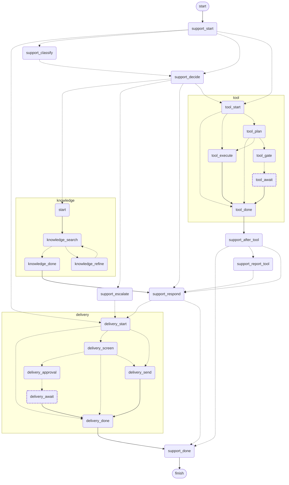
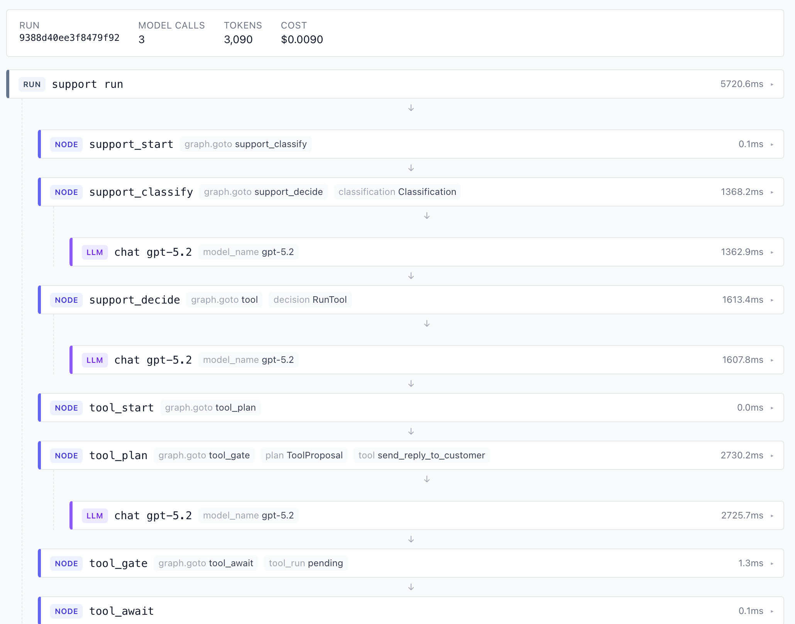

> **TL;DR** Three subgraphs, one responsibility each, each with its own state and its own agents. That is a multi-agent system: a supervisor routing to specialists. The difference from the handoff style is who holds the thread. A subgraph is a node, and a node returns, so the parent is always the thing deciding what happens next. You give up an agent's freedom to run off with the conversation and you get a topology you can export from the code and a span per step in a trace. Which of the two ways to compose one is decided by whether the state schemas overlap, not by taste.

The series has been building one graph. This is where it stops being one graph.

A word on which kind of multi-agent this is, because the term covers two different things. Not autonomous agents negotiating with each other and deciding among themselves who does what. A supervisor that routes to specialists, each owning one responsibility, which is the pattern most products actually ship. The specialists here are subgraphs.

## Table of contents

## One responsibility each

The support graph routes to three places that are themselves graphs:

```python
graph.add_node("knowledge", KnowledgeGraph(self.config, self.emit).subgraph())
graph.add_node("tool", ToolGraph(self.config, self.emit).subgraph())
graph.add_node("delivery", DeliveryGraph(self.config, self.emit).subgraph())
```

`knowledge` searches, judges what it found, and searches again with better terms if it has attempts left. `tool` proposes a call, clears it with a person when the tool is irreversible, and runs it. `delivery` screens a draft, decides whether a human should see it first, and sends it. Each has a job, a state schema of its own, and a boundary.

They are not thin wrappers either. `knowledge` owns a `RefinerAgent` that rewrites a failed search query; `tool` owns a `ToolPlannerAgent` that picks the tool and its arguments. The parent runs a classifier, two deciders and two answerers, depending on who is asking. Seven agent classes across four graphs, and each subgraph holds the ones its job needs.

That is the whole reason for splitting. The [LangGraph docs](https://docs.langchain.com/oss/python/langgraph/use-subgraphs) give the same three, in this order: building multi-agent systems, reusing a set of nodes in more than one graph, and letting different teams work on different parts independently. `delivery` is reachable from three places in the parent, so the approval logic lives in it once instead of at each call site, and somebody could own it without reading the other two.

## The same thing, seen from two angles

A subgraph with its own state, its own agents and its own decisions, that a supervisor hands control to, is an agent in a multi-agent system. The two words describe one object. Which word you reach for mostly says which problem you were thinking about when you named it.

So the real question is not whether to build a multi-agent system. It is which shape, and the fork is who holds the thread.

| | **handoff**: agent A gives the thread to B | **subgraph**: the parent calls B and gets control back |
| --- | --- | --- |
| After B finishes | B decides what happens next | the parent decides |
| The topology | emerges from what the agents choose | declared, and exported from the code |
| In a trace | a conversation to reconstruct | a span per node, nested |
| Adding a specialist | another agent to tell the others about | a node and an edge |
| An agent going off-script | possible, sometimes the point | cannot: a node returns |

Neither column is wrong. A handoff is the right shape when the next step genuinely depends on judgement the supervisor cannot make, and when you want an agent to be able to take the conversation somewhere nobody planned. Research assistants and open-ended copilots live there.

For a support product the second column is what you want, and the reason is in the last row. "An agent cannot go off-script" is a cost in an open-ended assistant and the entire point in a system that issues refunds. The parent always gets control back, because `delivery` is a node and a node returns, so there is exactly one place deciding what happens after a reply is screened, and it is code you can read rather than a model's choice you have to audit afterwards.

The row I would weigh second is the trace. In a handoff system, answering "why did it do that" means reconstructing a conversation between agents from their messages. Here it is a tree, and the next section is a picture of one.

## What that buys, in two pictures

This is the real export, not a diagram anybody drew. `xray` is a parameter on the compiled graph's drawing call, `get_graph(xray=True)`, and it takes a depth: truthy expands composed subgraphs inline, falsy draws each as a single opaque node, an integer expands that many levels. The app serves both at `/graphs`.



Three things to read off it. `knowledge` contains a loop, search to refine and back, which is a specialist retrying its own job without the supervisor knowing. Each subgraph has one way in and one way out, so an early exit lands on its own finish rather than reaching past it into the parent's, and the parent has one too in `support_done`. And the two nodes with a dashed border are the only places a run stops and waits for a person, a marking derived from each node's own source rather than from a list, because a hand-kept list of which nodes stop would go stale exactly here, in the picture most people look at instead of the code.

The second picture is a run of it:



Every node is a span, nested under the run, with where it routed and what it decided recorded beside it. The supervisor picking a specialist is one line, the specialist's own planning is the next, and each model call sits under the node that made it. Nobody wrote logging for any of that; it falls out of each step being a node.

The last row is where this run stopped and waited for somebody, which is part 7's subject.

## Which of the two ways to compose one

LangGraph also lets you call a graph from inside an ordinary node, `await other.ainvoke(...)`. This is not a matter of taste, and the docs are specific about it:

- The schemas **share keys**, so the subgraph reads and writes the same channels as the parent: pass the compiled graph to `add_node` directly.
- The schemas **differ**, or state needs transforming between them: invoke it inside a wrapper node that maps parent state in and the result back out.

These three share keys with the parent, so they go in as nodes. The mixins in `graphs/states/` are that sharing written down, which is why the contract between a parent and a specialist is a named thing rather than nine fields that happen to be spelled the same way in two files.

What you lose by invoking inside a node is everything in the two pictures above. One box in the diagram, one span in the trace, and a boundary nobody can see.

## A supervisor routes, a specialist does not

A subgraph cannot say where the parent goes next. That is the handoff column's freedom, given up, and it is what this column is made of: a specialist that could redirect the parent would be a handoff with extra steps.

It is easy to read that as a constraint on *how* the parent routes, and it is not. The parent decides; the decision is an ordinary node like any other:

```python
async def support_after_tool(
    self, state: SupportState
) -> Command[Literal["support_report_tool", "support_respond", "support_done"]]:
    """Where a run goes once the tool subgraph hands control back."""
    if state.tool_run is ToolRun.PENDING:
        return Command(goto="support_done")
    # A planner finding no tool is not a tool call.
    if state.tool:
        return Command(goto="support_report_tool")
    return Command(goto="support_respond")
```

[Part 4](/posts/agent-graph-engineering/the-agent-and-the-graph/) worked through `Command` versus conditional edges and landed on this: every route here is a `Command` node, every edge is a plain `add_edge`, and the signature's `Literal` lists where a node can send a run. The handover after a subgraph looked like the one place that had to be an edge, and making it a node put it back on the diagram and gave it a span.

Specialists are reusable *because* they are ignorant of who called them. This is the price.

## Where a run stops

One line in `support_after_tool` above is doing something the rest of this post has not explained: `tool_run is PENDING` means the tool subgraph did not finish its job, it stopped to ask somebody. Both dashed nodes in the diagram are that.

Giving a specialist the ability to wait for a human is a design problem of its own, with a real fork in it, and LangGraph has an answer, `interrupt()`, that is worth understanding before you decide against it. [Part 7](/posts/agent-graph-engineering/a-run-that-stops-for-a-person/) is that post.

What matters here is only that stopping is a property one of these modules happens to have, not the reason any of them exists. `knowledge` never stops. `tool` and `delivery` do, because the jobs they own involve money and customers. The split came first.

## Bounds belong together, not where they loop

One more structural habit, and the only one here with nothing to do with LangGraph. A limit that constrains another limit has to be readable next to it, or nobody can check the arithmetic. That is as true of timeouts against a client deadline, or pool sizes against a connection cap, as it is of anything below.

Composing specialists makes this worse, because a worst-case path now runs through graphs you are not looking at. Every limit a run is subject to lives in one file, and the reason is in its first line:

> A loop whose ceiling is written where it loops is a ceiling nobody can check against the others. These are together because they constrain each other: the recursion limit has to leave room for the worst case the retry limits allow.

Two of them, with their arithmetic:

```python
# One retry. A second empty result means the article does not exist, and looping
# on a model's guesses is how a miss turns into a bill.
KB_MAX_ATTEMPTS = 2

# Super-steps for a whole run, subgraphs included. The longest path is
# classify -> decide -> knowledge (search, evaluate, refine per attempt) ->
# respond -> delivery (screen, gate, send), which is well under this; the margin
# is for a parent that gains a branch without anyone revisiting this file.
GRAPH_RECURSION_LIMIT = 150
```

Scatter the ceilings and nobody can tell whether the global one leaves room for the local ones, so the first symptom is a legitimate long run hitting the recursion limit and looking like an infinite loop.

## What it costs

Subgraph boundaries are a commitment. Moving a node across one changes what merges when, so splitting a specialist later is not a refactor you do casually. Get the responsibilities roughly right before you draw the lines, which mostly means waiting until you have two call sites rather than imagining one.

A supervisor is a bottleneck by design. Every decision about what happens next goes through one graph, which is exactly what makes the topology readable and exactly what you would miss if your problem genuinely needed specialists negotiating among themselves.

And the state contract is real coupling. Shared keys are what let a subgraph go in as a node, so the parent and the specialist agree on a schema. Named mixins make that agreement visible, but it is still an agreement, and changing one side means thinking about the other.

Next up is the half this post deferred: what it takes for one of these specialists to stop and wait for a person, why `interrupt()` is the documented answer, and why a graph that changes every sprint ends up somewhere else.

Hope this one is useful. If you have built the handoff shape instead and it earned its keep, I would read that gladly, and if you have tips of your own on where to draw the lines, pass them on.

I write these deep-dives and maintain a handful of Python libraries, so if that is your kind of thing, follow along on [GitHub](https://github.com/huynguyengl99) and [LinkedIn](https://www.linkedin.com/in/huynguyengl99/).
