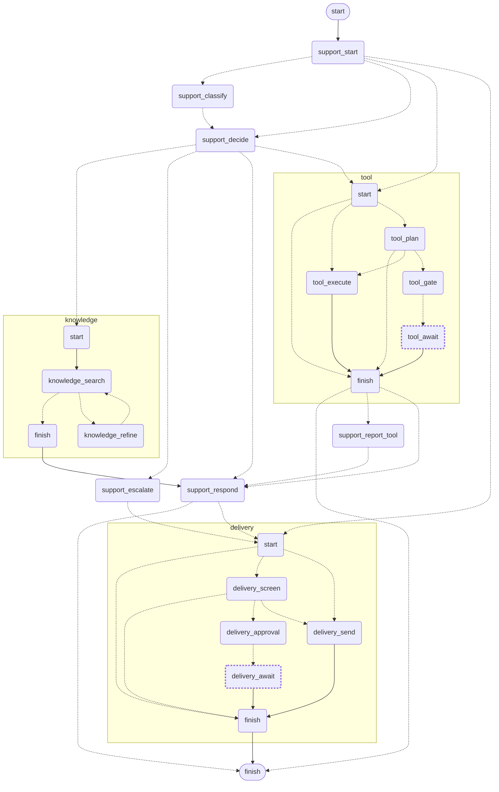

> **TL;DR** Composing is the easy half: a subgraph is a graph in its own right, with its own state and its own start and finish, that a parent mounts at one position in its own. The parent only ever sees a node, which is why the parent is the one that routes after it, and why the subgraph's start is free to be a router that decides where a run begins. Stopping for a human is the hard half, and I got it wrong the first time. I built it on `interrupt()` and a Postgres checkpointer, which works and is what the docs show. Then a reader asked why the agent needed a database at all, I could not answer it well, and tearing both out took a day and left the system smaller: a gate now **ends** its subgraph, the whole state goes back to the caller, and the decision arrives as a new run carrying it. Two durable copies of a thread became one. Three bugs fell out of the switch, and one of them refunded money twice.

This is the post I would have wanted most, and the reason is simple. Everything up to here you could have worked out from the docs in an afternoon. This part I learned by getting it wrong, shipping the wrong thing, and then having to explain it to somebody.

They are in one post because they are one capability. A flow large enough to need a human in it is large enough to need composing, which is subgraphs. Where a half-finished run lives between the two halves of a turn is the other question, and it is the one with an actual decision in it.

## Table of contents

## Subgraphs: composing without composing spaghetti

The support graph routes to three places that are themselves graphs: searching the knowledge base, running a tool, and delivering a reply. Each is compiled on its own and mounted in the parent at one position, which `add_node` is the method for:

```python
graph.add_node("knowledge", KnowledgeGraph(self.config, self.emit).subgraph())
graph.add_node("tool", ToolGraph(self.config, self.emit).subgraph())
graph.add_node("delivery", DeliveryGraph(self.config, self.emit).subgraph())
```

You had a choice here, and the post would be dishonest not to say so. LangGraph will also let you call a graph from inside an ordinary node: `await other.ainvoke(...)`, no composition involved. That version is easier, and for a one-off it is the right call.

The difference between the two is the difference between a black box and a white one, and that is the whole decision.

| | **black box**: invoked inside a node | **white box**: a compiled subgraph |
| --- | --- | --- |
| In the diagram | one box | expands inline with `xray` |
| In a trace | one span | a span per inner node |
| State | whatever you pass and return | its own schema, merged on return |
| Reuse | a function call | added as a node by any parent |
| Where it stopped | inside a function you have to read | a node, with a name, on the picture |

Every row is about whether you can see inside the thing after it runs. A black box is fine until you have to explain why a run did what it did, at which point it is one node in the picture and one span in the trace and you are back to reading code.

The last row carried the most weight for me, and it did not look that way at first. Somewhere in here a run stops and waits for a person, and "where" is the first question anyone asks about it, including me six months later.

Reuse is the quieter benefit. `delivery` is composed by the support graph today, and nothing stops another flow adding the same compiled object as a node, because it declares its own state and says nothing about who contains it.

That is the whole composition story, and it is the part that works smoothly. The parent does not know what `delivery` does. It knows the name, and that control comes back afterwards.

Expanded, the whole thing looks like this. It is the same export with `xray` on, which inlines each subgraph instead of drawing it as one box, and it is exactly what `/graphs` serves in the app. Each subgraph has its own start and finish, which matters more than it looks: those are what the early exits route to.



A dashed, thicker outline marks a node where the run stops and waits for a person, and those two are the only places that happens. The marking is derived from each node's own source rather than from a list, because a hand-kept list of which nodes stop would go stale exactly here, in the picture most readers look at instead of the code.

Four things are worth reading off it. `knowledge` contains a loop, search to refine and back, which is the bounded retry further down this post. `tool` has a gate in the middle of it. `delivery` is reachable from three different places in the parent, which is why the approval logic lives there once rather than at each call site.

And every subgraph can reach its own finish early. `tool_plan` can stop without running anything, the gate ends the subgraph instead of executing, and `delivery_screen` can end without sending. Those edges are the rejections and the stops, and they are the reason a subgraph needs a finish of its own rather than always handing control back with a result.

Notice also that every subgraph's own `start` has conditional edges out of it. That is not decoration, and the rest of this post is mostly about why.

### A parent routes after a subgraph

The structural rule that bites first: a subgraph cannot say where its parent goes next. [Part 4](/posts/agent-graph-engineering/the-agent-and-the-graph/) showed nodes returning `Command[Literal[...]]` to name their own destination. A subgraph has no such power, because it does not know the parent's topology.

So the parent does it, which is why this codebase has a separate routing function:

```python
def route_after_tool(self, state: SupportState) -> str:
    """A method rather than a `Command`, because only a parent can route
    after a subgraph.

    A gate inside the subgraph ends the run rather than suspending it, so
    the parent has to notice: carrying on here would report and answer a
    tool call that has not happened yet.
    """
    if state.awaiting is not Resuming.NOTHING:
        return "__end__"
    # A planner finding no tool is not a tool call.
    return "support_report_tool" if state.tool else "support_respond"
```

Worth internalising as a design constraint rather than a quirk. Subgraphs are reusable _because_ they are ignorant of who called them. The price of that reuse is that the caller owns the transition.

That second paragraph of the docstring is a bug I wrote, and I will come back to it.

## Two kinds of state, and only one of them is yours

Before the interesting part, the distinction [Part 2](/posts/agent-graph-engineering/split-the-services/) argued for, because everything below depends on it.

The **business record** is what a person reads: the ticket, the messages, who said what. It is derived, it can be recomputed, and the backend owns it.

The **execution state** is which node runs next, the channel values, what the gate is holding. It is not a record of anything. Nobody reads it. Its only purpose is to let a half-finished run carry on.

Those are genuinely different, and conflating them is how you end up writing a resume by hand against a half-remembered graph. What is *not* obvious, and what I had wrong, is where the second one has to live.

## Where a stopped run lives

LangGraph's answer is `interrupt()` and a checkpointer, and it is a good answer. The node calls `interrupt()`, the graph writes a checkpoint, the call stack unwinds, and the process is free. A resume delivers a value and execution continues from inside that function as though it had never stopped. Mid-node, mid-subgraph, anywhere.

That is what I shipped. It worked. The gate is two levels down from the entry point and a resume reached it correctly, which it does only because the whole tree shares the parent's checkpointer: give a subgraph its own and it checkpoints into its own thread, the parent's resume has no idea the child is waiting, and the symptom is not an exception but a reviewer clicking approve and nothing at all happening.

Then somebody read the repo and asked why the agent needed its own Postgres. I gave an answer about fast recovery and mid-node resumption, went to check it, and found that neither applied here. `delivery_approval` preserves no local variables worth resuming into. One entry router handles both gates. I was defending a mechanism, not a requirement.

Here is the comparison I should have drawn before writing the first version:

| | `interrupt()` plus a checkpointer | end the run, resume from the entry |
| --- | --- | --- |
| Durable copies of one thread | two | one |
| Who writes the resume | the framework | you, once per gate |
| What survives | every channel value, automatically | what you deliberately hand back |
| Growth | per thread per super-step | one record, overwritten |
| Where a stop may be | anywhere, including mid-node | only where the graph can cleanly end |
| Serialization | the framework's format and its allowlist | your own, usually JSON |
| Agent processes | the one holding the thread | any of them |
| If the saved state will not load | you need a recovery path | discard it and carry on |

The row I underrated is the first one. Two durable copies of one thread is not a performance cost, it is a correctness cost, and it shows up in the quietest way possible: the backend knows a reply is waiting for approval, the agent knows a run is parked, and nothing enforces that those two agree. A deploy, a reset, a thread that will not deserialize, and the browser shows a card whose run no longer exists. I built the escape hatch for that, which is a sentence I should have read as a warning rather than as progress.

The last row has the same shape. State you hand back can be thrown away when it no longer parses, and the conversation continues from the record. A checkpoint cannot be thrown away, because the checkpoint **is** the run.

And the serialization row turned out to be a live deadline rather than a theoretical one. Graph state holds Pydantic models, and today, on the defaults, they survive the round trip. What you also get is this, on every single resume:

```
Deserializing unregistered type assistant.outputs.support.RunTool from
checkpoint. This will be blocked in a future version. Set
LANGGRAPH_STRICT_MSGPACK=true to block now, or add to
allowed_msgpack_modules to allow explicitly.
```

Turn strict mode on, which is what a future version does for you, and an unregistered model stops being a model:

```python
# LANGGRAPH_STRICT_MSGPACK=true, type not allow-listed
{"decision": {"reasoning": "Refund it."}, "q": "hi"}
#             ^ a plain dict, not a RunTool
```

So `isinstance(decision, RunTool)` is `False`, and a router falls through to the branch it takes when it has no decision. A resumed run quietly does something different from what it was doing before it stopped. No exception, one log line, and the symptom reads like the model made an odd choice. The fix is an allowlist of `(module, qualname)` pairs derived from the unions rather than typed out by hand, and I wrote that, and it is fine, and it is also a format I do not control being load-bearing in the one code path that handles money.

So I moved it. The agent is stateless between requests now.

## What that actually looks like

Two fields, shared by every graph:

```python
class Resuming(StrEnum):
    """Which pause this run is picking up, if any.

    A run ends at a gate rather than suspending inside it, so resuming is a
    new run carrying the state the last one finished with. This says which
    entry it should take instead of starting from the top.
    """

    NOTHING = ""
    TOOL_APPROVAL = "tool_approval"
    REPLY_APPROVAL = "reply_approval"


class BaseState(BaseModel):
    context: Context
    # Set by the backend when it sends a reviewer's answer back, read by the
    # entry router of whichever graph owns that gate.
    resuming: Resuming = Resuming.NOTHING
    # Set by a gate on its way out, so the caller knows the run stopped for a
    # person rather than finishing.
    awaiting: Resuming = Resuming.NOTHING
```

A gate tells whoever is watching, says what it is waiting on, and routes to a node that does nothing:

```python
async def tool_gate(self, state: ToolState) -> Command[Literal["tool_await"]]:
    """Stop the run with the proposal on the table.

    The reviewer's answer arrives as a new run rather than as a value
    returned into this function, so the only thing left to do here is say
    what is being waited on and let the graph finish.
    """
    await self.emit(ToolApprovalMessage(payload=...))
    return Command(update={"awaiting": Resuming.TOOL_APPROVAL}, goto="tool_await")

async def tool_await(self, state: ToolState) -> ToolState:
    """Where the run stops while a person decides.

    A node that does nothing, on purpose. Ending here rather than
    suspending inside the gate makes the stop a place on the graph: it is
    drawn, it gets its own span, and the state the run finished with is
    the whole of what a resume needs.
    """
    return state
```

That empty node is the part I like most, and it is the part that looks silliest in a diff. An `interrupt()` is invisible: it is a function call in the middle of a node, it draws nothing, and finding every place a run can stop means grepping. `tool_await` is a box on the picture with a dashed border. The same is true in a trace: the stop has a span, with a duration, which is how long the human took.

Then the entry router, which is the resume:

```python
def entry(self, state: ToolState) -> str:
    """Where a run enters this graph.

    A fresh run plans a tool. A run carrying an approved gate skips
    straight to running it, because the planning already happened in the
    run that stopped.
    """
    if state.resuming is Resuming.TOOL_APPROVAL:
        return "tool_execute" if state.approved else "__end__"
    return "tool_plan"
```

That is the whole mechanism. Per gate it is three or four lines, and it is readable by someone who has never used LangGraph. The parent has the same shape one level up, routing a resume straight into the subgraph that stopped rather than through the work that already happened:

```python
match state.resuming:
    case Resuming.TOOL_APPROVAL:
        return Command(update={"awaiting": Resuming.NOTHING}, goto="tool")
    case Resuming.REPLY_APPROVAL:
        return Command(update={"awaiting": Resuming.NOTHING}, goto="delivery")
```

On the wire, every run now ends the same way, whether it answered or stopped:

```python
await emitter_for(self)(
    RunEndedMessage(
        payload=RunEndedPayload(
            thread_id=self.thread_id,
            awaiting=str((final or {}).get("awaiting") or Resuming.NOTHING),
            state=SupportState.model_validate(final).model_dump(mode="json"),
        )
    ),
)
```

The backend stores that blob against the ticket and the audience, and sends it back with the decision. The agent compiles its graph with no checkpointer and forgets everything.

Two smaller things fell out that I did not expect. The relay stopped guessing which event was the last one, because now there is exactly one terminal event instead of five that each might be. And the findings a reviewer needs no longer have to ride the stop payload: a subgraph's writes merge into the parent when it **returns**, and this one returns, so everything the parent needs has already landed by the time the run ends.

## The three bugs that fell out of the switch

This is the part worth reading twice, because the migration looked finished long before it was. All three were caught by converting tests that already existed, which is the entire argument for having written them.

**A stopped subgraph did not stop the parent.** The tool gate ended its subgraph cleanly, control went back to the parent, and the parent did what it always does after the tool subgraph: reported the tool call and drafted an answer about it. The tool had not run. A reviewer was looking at a card asking permission for a refund that the customer had already been told about. That is the `if state.awaiting is not Resuming.NOTHING: return "__end__"` in `route_after_tool`, and under `interrupt()` the problem could not exist, because the parent never got control back at all.

**A resumed run ended immediately.** The carried state still said `awaiting: tool_approval`, because that is what the run that stopped ended with. So the check I had just added read it and ended the run on the spot. Clearing the mark on the way in is one line in the parent's entry, and the bug it fixes is a reviewer approving something and watching nothing happen, which is the same symptom as the subgraph-checkpointer mistake and a completely different cause.

**The refund fired twice.** This one is the reason I am glad it was tests and not production. Irreversible tools go through an at-most-once ledger keyed on the run and the node, so a retry returns the first attempt's result rather than making a second call. The key was built from LangGraph's `checkpoint_ns`, which looks like `node:task-uuid`, and that uuid is minted per invocation. Under the old design the same invocation was resumed, so the key held. Under the new one the resume is a new invocation with a new uuid, so the ledger saw a different call, claimed it, and refunded again.

```python
# The namespace is "node:task-uuid", and the uuid is minted per invocation.
node = namespace.split(":", 1)[0]
return f"{thread}:{node}:{tool}"
```

Three lines. The test that caught it asserts the refund tool was called once, and it had been passing for weeks against a design where that was true for a different reason.

There was a fourth, found later and not by a test: a reviewer's rewritten draft was passed to the resumed run beside the state rather than inside it, as a key no state field matches. Pydantic drops an unknown key without a word, so the model's own draft went to the customer and the reviewer's words went nowhere. The graph-level tests built that state by hand and never saw it. It has a test at the level where it broke now.

### Accept, edit, or reject

Three outcomes, and the middle one is the one that matters.


A reviewer can change the draft, or the tool's arguments, on the way through. The resumed run does what the human wrote, not what the model wrote: correcting £29 to £9 means £9 is what gets refunded. In practice this is the feature that makes an approval gate tolerable. Without it, a reviewer with a small objection has to reject, which discards the work, which means they stop using the gate and start doing the job by hand.

It also needs one thing said out loud to the model afterwards. A live run answered a corrected £9 refund by telling the rep to refund the missing £20, which is the reviewer's decision being undone by the summary of it. So the state carries whether the arguments were changed, and the prompt says that is the decision rather than a mistake.

Rejection is recorded as an outcome rather than silently dropping everything, and a rejected draft is deliberately never written to the ticket log, so a reply the customer never saw leaves no trace suggesting they did.

## So which should you use

Not a recommendation, a rule, and it is the one row of that table that decides it:

**If every stop lands where the graph can cleanly end, end it.** Hand the state back, resume from an entry router, and you get one durable copy of a thread, an agent process that holds nothing, a payload you can read in a log, and bounded growth. You give up nothing you were using.

**If a stop lands mid-flight**, inside real work you cannot cheaply redo, take the checkpoint. That is what it is for, and rebuilding it by hand would mean reimplementing an execution model.

I had one of each, or thought I did. `delivery_approval` is a turn boundary in all but name, since only a send follows it. `tool_gate` looked like the hard case: after it the tool runs, the parent writes a report, another model call drafts an answer, and delivery can stop again at a different gate. But "work follows the stop" is not the same as "the stop is mid-work". Everything after that gate is reachable from an entry router with the state in hand, which is exactly what the four lines above do. The harder of the two sets the architecture, and I had mistaken which one it was.

The honest version of the rule is uglier and more useful: **write down what a resume would actually need, before deciding you cannot write it down.** It took me twenty minutes once I stopped assuming.

## Bounds belong together, not where they loop

One more structural habit, and the only one here with nothing to do with LangGraph. **A limit that constrains another limit has to be readable next to it, or nobody can check the arithmetic.** That is as true of timeouts against a client deadline, or pool sizes against a connection cap, as it is of anything below.

Every limit a run is subject to lives in one file, and the reason is in its first line:

> A loop whose ceiling is written where it loops is a ceiling nobody can check against the others. These are together because they constrain each other: the recursion limit has to leave room for the worst case the retry limits allow.

Two of them, with their arithmetic:

```python
# One retry. A second empty result means the article does not exist, and looping
# on a model's guesses is how a miss turns into a bill.
KB_MAX_ATTEMPTS = 2

# Super-steps for a whole run, subgraphs included. The longest path is
# classify -> decide -> knowledge (search, evaluate, refine per attempt) ->
# respond -> delivery (screen, gate, send), which is well under this; the margin
# is for a parent that gains a branch without anyone revisiting this file.
GRAPH_RECURSION_LIMIT = 150
```

A graph with subgraphs and retries has a worst-case path length that is not obvious from any one file. Scatter the ceilings and nobody can tell whether the global one leaves room for the local ones, so the first symptom is a legitimate long run hitting the recursion limit and looking like an infinite loop. Writing the longest path out in a comment means the next person can check the arithmetic instead of guessing at it.

## What it costs

**Every decision carries the state back.** It is a JSON blob of a couple of kilobytes on a WebSocket that is already open, so in this system it is free. On a different shape, a huge state or a chatty gate, it would not be, and that is the trade you are making.

**A new question must not inherit the last run's state.** This is the sharp edge of carrying it yourself, and it cost me a test to find. Send the whole blob into a fresh turn and the second question arrives with the first one's receipt, approval and answer already set, and routers behave accordingly. So the agent reads the carried state two ways: a decision continues the run it came from and takes the state whole, a new question takes only what the thread is meant to remember. Those are four lines each and they are the two most load-bearing functions in the service.

Subgraph boundaries are a commitment. Moving a node across one changes what merges when. Splitting a subgraph later is not a refactor you do casually.

One run at a time per lane, and that took a bug to learn. One state blob is kept per ticket and audience, so two runs in one lane are two graphs writing one thread and the second wins. A reply waiting at the gate could be lost when a later message started another run and replaced the state behind it. A run now claims its lane and holds the claim _through_ a stop, because waiting for a person is not the same as being finished.

Debugging a resume is still harder than debugging a run, though less than it was. The state came from a database and the run has no history of how it got there. The difference is that the state is now JSON somebody can read, in a table somebody can query, rather than a msgpack blob in a framework's schema. The trace is what saves you either way, which is post 9.

Next up is the realtime half: why the backend talks to the agent over a WebSocket rather than a queue, and how a node buried in a subgraph streams progress to a browser without the graph knowing anything about sockets.

Hope this one is useful. If you have shipped a human-in-the-loop gate and landed somewhere different, I would read that gladly, and if you have tips of your own on where to keep a half-finished run, pass them on.

I write these deep-dives and maintain a handful of Python libraries, so if that is your kind of thing, follow along on [GitHub](https://github.com/huynguyengl99) and [LinkedIn](https://www.linkedin.com/in/huynguyengl99/).
