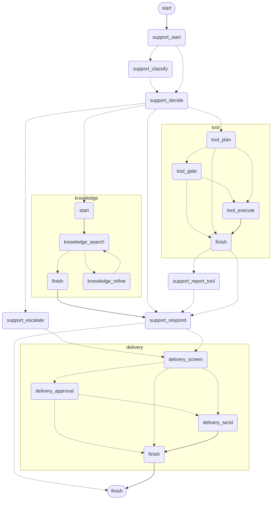
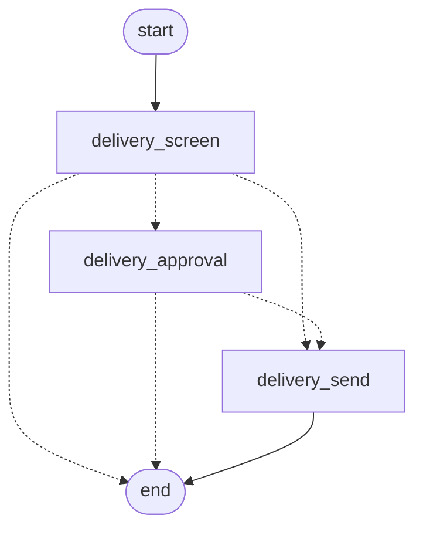
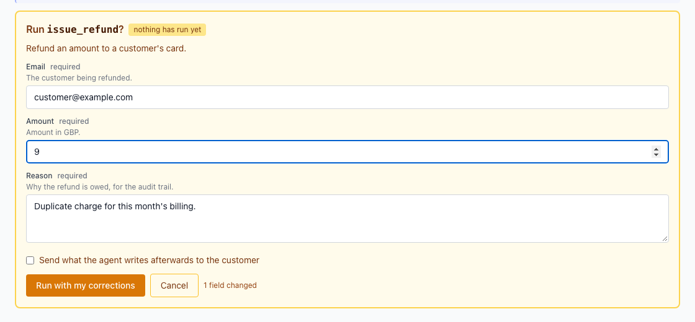

> **TL;DR** These three are one mechanism, not three topics. A subgraph is a compiled graph used as a node, and it must be compiled **without** its own checkpointer so a resume can reach an interrupt one level down. Persistence holds execution state, which is not your business record and cannot be rebuilt by hand. An interrupt parks a run mid-flight, and it only works because the checkpoint exists. The details that cost me the most: a resume hands Pydantic models back as plain dicts, and a subgraph's writes do not reach its parent until it returns, so anything the reviewer needs has to ride the interrupt itself.

This is the post I would have wanted most, and the reason is simple. Everything up to here you could have worked out from the docs in an afternoon. This part I learned by getting it wrong in production, and the failures were quiet.

They are in one post because they are one capability. A graph that can pause for a human needs state that outlives the request, which is persistence. A flow large enough to need pausing is large enough to need composing, which is subgraphs. And the pausing itself has rules that only make sense once you know how the other two work. Teaching them separately means explaining the same mechanism three times with two thirds of it missing.

## Table of contents

## Subgraphs: composing without composing spaghetti

The support graph routes to three places that are themselves graphs: searching the knowledge base, running a tool, and delivering a reply. Each is a compiled graph used as a node:

```python
graph.add_node("knowledge", KnowledgeGraph(self.config, self.emit).subgraph())
graph.add_node("tool", ToolGraph(self.config, self.emit).subgraph())
graph.add_node("delivery", DeliveryGraph(self.config, self.emit).subgraph())
```

That is the whole composition story, and it is the part that works smoothly. The parent does not know what `delivery` does. It knows the name, and that control comes back afterwards.

Expanded, the whole thing looks like this. It is the same export with `xray` on, which inlines each subgraph instead of drawing it as one box, and it is exactly what `/graphs` shows in the app. Each subgraph has its own start and finish, which matters more than it looks: those are what the early exits route to.



Four things are worth reading off it. `knowledge` contains a loop, search to refine and back, which is the bounded retry from earlier in this post. `tool` has a gate in the middle of it. `delivery` is reachable from two different places in the parent, which is why the approval logic lives there once rather than at each call site.

And every subgraph can reach its own finish early. `tool_plan` can stop without running anything, `tool_gate` can stop instead of executing, and `delivery_screen` and `delivery_approval` can both end without sending. Those edges are the rejections, and they are the reason a subgraph needs a finish of its own rather than always handing control back with a result.

### The detail that breaks everything

Here is the helper that produces those subgraphs. The thing that took me longest to find is what is missing from it:

```python
def subgraph(self) -> CompiledStateGraph[Any, Any, Any, Any]:
    """Compiled for a parent to add as a node: it shares the parent's
    checkpointer, so a resume reaches an interrupt one level down."""
    return self.build().compile()
```

A compiled graph can have a checkpointer. A subgraph must not. If you give a subgraph its own, it checkpoints into its own thread, and the parent's resume has no idea the child is parked. The approval interrupt lives inside the delivery subgraph, two levels down from the entry point, and it is only reachable on resume because the entire tree shares the parent's checkpointer.

The symptom when you get this wrong is not an exception. It is a run that parks, a reviewer who clicks approve, and nothing happening. Which is exactly the kind of bug that eats a day, because every individual piece looks correct in isolation.

### A parent routes after a subgraph

The other structural rule: a subgraph cannot say where its parent goes next. [Part 4](/posts/agent-graph-engineering/the-agent-and-the-graph/) showed nodes returning `Command[Literal[...]]` to name their own destination. A subgraph has no such power, because it does not know the parent's topology.

So the parent does it, which is why this codebase has a separate routing function with a comment saying precisely that:

```python
def route_after_tool(self, state: SupportState) -> str:
    """... not a `Command` because only a parent can route after a subgraph."""
```

That is worth internalising as a design constraint rather than a quirk. Subgraphs are reusable _because_ they are ignorant of who called them. The price of that reuse is that the caller owns the transition.

## Persistence: the state you cannot rebuild

The checkpointer's own docstring makes the distinction that [Part 2](/posts/agent-graph-engineering/split-the-services/) argued for:

> This is not the business record. The backend's Postgres rows are what the customer sees; this holds the _execution_ state: which node runs next, the channel values, the pending interrupt payload. Rebuilding that by hand would mean reimplementing LangGraph's execution model, and resume is the only reason the approval gate works at all.

Two services, two kinds of state. The record is derived and can be recomputed. Execution state cannot, and losing it means losing the ability to continue.

### In-memory is a trap, so it is opt-in

LangGraph ships an in-memory saver and it is the obvious default while developing. The docstring explains why it is not the default here:

> In memory it survives a reconnect but not a restart, which means a deploy silently drops every reply waiting on a reviewer. So Postgres is the default and the in-memory saver is opt-in, announced loudly when it happens.

Read that failure mode carefully, because it is nastier than it sounds. Every draft waiting for a human disappears on deploy. No error. No log line, unless you wrote one. Customers simply never get the reply somebody approved, and nobody notices until one of them asks again. The in-memory saver is correct for tests and actively dangerous anywhere else, so it announces itself when selected.

### The serializer has an allowlist, and deriving it matters

Graph state holds Pydantic models, and they have to survive a round trip through the serializer. The set of permitted types is explicit:

```python
# Every model a graph state can hold. A missing one comes back as nothing rather
# than an error, so a router reads no route and takes its fallback branch.
# Derived from the unions, because listing it by hand is what went wrong.
CHECKPOINTED: tuple[Any, ...] = (
    Audience, Context, Ticket, Turn,
    Classification, TicketAnswer, ...
)
```

Both comments are scars.

A type missing from that list does not raise. It comes back as nothing. So a router reads `state.decision`, finds `None`, and takes its fallback branch, which means a resumed run quietly does something different from what it was doing before it parked. That is as close to an undebuggable bug as this codebase gets, and the only reason it is tractable is that the behavior is now written down where someone will read it.

And the list is **derived from the unions** rather than typed out, because maintaining it by hand is what produced the problem in the first place. Somebody adds a member to a decision union, does not think about serialization, and a specific resume path breaks weeks later. Deriving it means the two cannot drift.

### Everything comes back as a dict

The one that bit hardest. A resume reloads state through the serializer, and Pydantic models arrive back as **plain dicts**. Your type annotation says `TicketAnswer`. At runtime, after a resume, it is a `dict`.

Which means `state.answer.content` works perfectly before an interrupt and raises `AttributeError` after one. Type checkers cannot see it, because the annotation is honest about intent and wrong about runtime.

The fix is unglamorous: re-validate at the boundary. This codebase has a small `_answer_of()` that takes whatever came back and returns a real model. The rule to carry: any model you read after an interrupt gets re-validated first. Write it on a sticky note, because you will add a field one day and reintroduce this.

A related gotcha in the same area: the allowlist takes `(module, qualname)` pairs, not module names. Getting it wrong only warns today and is slated to start raising.

## Interrupts: parking a run mid-flight

Now the payoff. The node that waits for a human:

```python
async def delivery_approval(
    self, state: DeliveryState
) -> Command[Literal["delivery_send", "__end__"]]:
    """Park the run until a human accepts, edits, or rejects the draft."""
    answer = state.answer
    # Findings ride the interrupt rather than the state: a subgraph's
    # writes only merge into the parent when it returns, and the reviewer
    # needs them now.
    decision = interrupt(
        {
            "kind": "reply_approval",
            "draft": answer.content,
            "findings": list(state.guardrail_findings),
        }
    )
```

The subgraph it sits in is three nodes, and every edge out of the first two is conditional, because most replies never stop for anyone:



`delivery_screen` decides whether a person is needed. Only the middle path parks.

`interrupt()` stops the run. The graph checkpoints, the call stack unwinds, and the process is free. Later, a resume delivers a value and execution continues from inside this function as though it had never stopped.

### Findings ride the interrupt, not the state

That comment is the second subgraph lesson and it is not obvious. A subgraph's writes to state **only merge into the parent when the subgraph returns.** A parked subgraph has not returned. So anything written to state before the interrupt is invisible to the parent, and therefore invisible to the backend relaying it, and therefore invisible to the reviewer.

The guardrail findings are exactly what the reviewer needs to judge the draft. If they go in state, they arrive after the decision, which is useless. So they travel in the interrupt payload, which crosses the boundary immediately.

The general rule: the interrupt payload is the only channel from a parked subgraph to the outside world. Put everything the human needs in it.

### The thread id is the ticket id

The last piece, and it is the one that makes this work in a browser rather than in a notebook.

The thread is keyed on the **ticket**, not on a connection or a session. So when a reviewer approves something twenty minutes later, on a different socket, possibly after a page reload, possibly on a different worker process, the resume still finds the parked run. The backend deliberately disconnects after `approval_required` and opens a fresh connection to resume.

That is only safe because the thread id is derived from durable business identity. Key the thread on a connection and your approval flow works in testing and fails the moment a reviewer takes a coffee break.

### Accept, edit, or reject

Three outcomes, and the middle one is the interesting one:

```python
edited = decision.get("content") if isinstance(decision, dict) else None
return Command(
    update={
        "approval_granted": True,
        "answer": answer.model_copy(update={"content": edited or answer.content}),
    },
    ...
)
```



A reviewer can change the draft on the way through. The resumed run sends what the human wrote, not what the model wrote. In practice this is the feature that makes an approval gate tolerable: without it, a reviewer with a small objection has to reject, which discards the work, which means they stop using the gate and start writing replies by hand.

Rejection is also recorded as an outcome rather than silently dropping everything, and a rejected draft is deliberately never written to the ticket log, so a reply the customer never saw leaves no trace suggesting they did.

## Bounds belong together, not where they loop

One more structural habit, which I did not have before this project. Every limit a run is subject to lives in one file, and the reason is in its first line:

> A loop whose ceiling is written where it loops is a ceiling nobody can check against the others. These are together because they constrain each other: the recursion limit has to leave room for the worst case the retry limits allow.

Two of them, with their arithmetic:

```python
# One retry. A second empty result means the article does not exist, and looping
# on a model's guesses is how a miss turns into a bill.
KB_MAX_ATTEMPTS = 2

# Super-steps for a whole run, subgraphs included. The longest path is
# classify -> decide -> knowledge (search, evaluate, refine per attempt) ->
# respond -> delivery (screen, gate, send), which is well under this; the margin
# is for a parent that gains a branch without anyone revisiting this file.
GRAPH_RECURSION_LIMIT = 150
```

A graph with subgraphs and retries has a worst-case path length that is not obvious from any one file. Scatter the ceilings and nobody can tell whether the global one leaves room for the local ones, so the first symptom is a legitimate long run hitting the recursion limit and looking like an infinite loop. Writing the longest path out in a comment means the next person can check the arithmetic instead of guessing at it.

## Why the order is not negotiable

If you take one structural thing from this post: **persistence has to be understood before interrupts, because an interrupt is only possible because the checkpoint exists.** People reach for human-in-the-loop first, since it is the visible feature, and then try to bolt it onto a graph with no durable state. It cannot work. The pause is not a feature of the gate; it is a consequence of being able to write down exactly where you were and pick it up somewhere else.

## What it costs

**Postgres is now on your critical path**, and a checkpoint write happens after every node. For a flow whose steps are model calls measured in seconds, that is invisible. For a hot loop it would not be.

Checkpoints accumulate. Nothing here prunes them. A long-lived thread grows forever, and a retention policy is work you still owe.

**Debugging a resume is harder than debugging a run.** The state came from a database, the models are dicts, and the failure happens inside a function that appears to have been called normally. The trace is what saves you, which is post 9.

Subgraph boundaries are a commitment. Moving a node across one changes what merges when. Splitting a subgraph later is not a refactor you do casually.

One run at a time per lane, and that took a bug to learn. Two runs on one thread are two graphs writing one state, and the second wins. A reply that was parked at the gate could be lost when a later message started another run and overwrote the interrupt. A run now claims its lane and holds the claim _through_ a park, because waiting for a person is not the same as being finished.

Next up is the realtime half: why the backend talks to the agent over a WebSocket rather than a queue, and how a node buried in a subgraph streams progress to a browser without the graph knowing anything about sockets. Hope this one is useful. If you are picking a place to be careful, make it the checkpointer and the dicts.

I write these deep-dives and maintain a handful of Python libraries, so if that is your kind of thing, follow along on [GitHub](https://github.com/huynguyengl99) and [LinkedIn](https://www.linkedin.com/in/huynguyengl99/).
