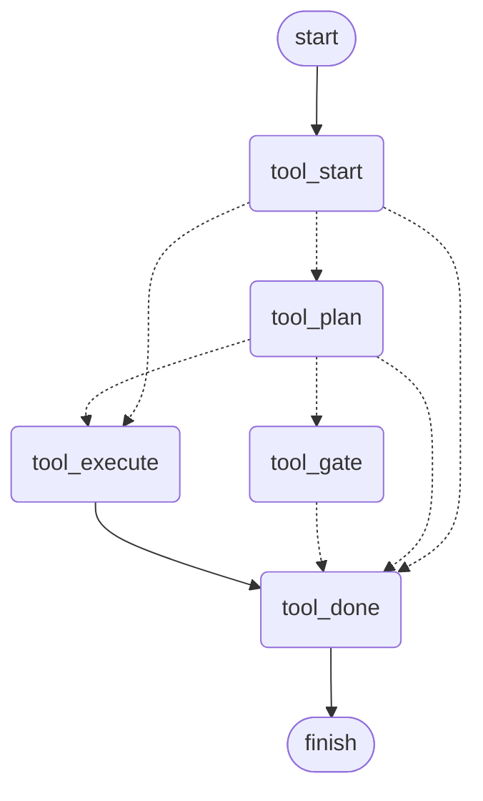

> **TL;DR** `interrupt()` is LangGraph's answer for stopping to ask a person, and it is the right one for a notebook or a script. On a product its rules all come from one thing: what gets saved is a position in your code. Rename a node a thread is waiting at and the docs say the run fails. It does not. The resume returns having done nothing, and the reply is never sent. Both designs save something; the question is what it describes. The other way saves how far the work got, which makes the statuses a state machine you wrote: the run ends, the answer arrives as a new one, and an entry router reads the status back. One design makes you write down what carrying on needs. The other lets you not think about it until a refund goes out twice.

Part 6 split one graph into specialists. Two of them, `tool` and `delivery`, own jobs that involve money and customers, so both have to be able to stop and ask somebody.

That sounds like a small feature. It is the decision that most shapes what the system is like to operate, because it is the one that decides what a half-finished run *is*.

## Table of contents

## Two kinds of state

The **business record** is what a person reads: the ticket, the messages, who said what. It is derived, it can be recomputed, and the backend owns it.

The **execution state** is whatever a half-finished run needs in order to carry on. It is not a record of anything and nobody reads it for its own sake. What it should contain is the choice this post is about: a position in the graph, or how far the work got.

Those are genuinely different, and conflating them is how you end up writing a resume by hand against a half-remembered graph. Where the second one lives while a person takes twenty minutes to answer is the whole of this post.

## The obvious answer, and what comes with it

If you are building human-in-the-loop on LangGraph you will meet `interrupt()` first. It is the documented answer, it is the first search result, and for a notebook, an internal script, or a graph that is not going to change much, it is the right call. You call it inside a node, the graph checkpoints, the call stack unwinds, and your process is free. Someone answers, you resume with a value, and the framework works out where you were. Nothing here makes that a bad tool.

What is worth knowing before you build a product on it is that the resume has rules, and the [docs](https://docs.langchain.com/oss/python/langgraph/interrupts) are blunt about them:

- **The node restarts from the beginning.** It does not continue from the line after `interrupt()`. Anything the node did before the interrupt runs again, so every side effect before one has to be idempotent.
- **Matching is strictly index-based.** The first `interrupt()` in a node matches the first resume value. You cannot conditionally skip one, and a `while True` loop around one replays every previous iteration.
- **You cannot wrap it in try/except,** because that swallows the exception the graph uses to unwind.
- **Values must be serializable.** Not only across deployments: the default serializer refuses a plain Python object outright, with `Type is not msgpack serializable`.

And the one that matters most over a product's life, [spelled out in the docs](https://docs.langchain.com/oss/python/langgraph/backward-compatibility): edges are free to change, because edge topology is not in the checkpoint at all, but a thread sitting at a node you rename or delete does not survive it. Resume dispatches by the node name saved in the checkpoint, and a node that is gone has nowhere to resume from.

The docs say the run fails. I ran it, because a documented rule is a claim about code, and it is quieter than that. On LangGraph 1.2.12, with the in-memory checkpointer and again with Postgres, a reviewer's approval arriving after the rename does this:

- The renamed node never runs, and nothing downstream of it does either.
- The pending interrupt is dropped.
- The thread is marked finished, holding the state it had before the answer.
- Nothing is raised, and nothing is logged.

So rename `delivery_approval` and deploy, and every reply waiting for a reviewer gets answered, accepted, and silently never sent, with the thread recorded as done. That is worse than failing, because failing is visible. The other four rules on that list behave exactly as documented. This is the one that does not.

Those rules are one constraint wearing five hats: the saved state is a position inside your code, so your code has to hold still around it. For a graph that ships once that is free. For one where the business asks for a new branch every sprint, it is a deploy checklist nobody will remember.

## The stop is a status

This system never pauses a run. How far the work has got is a field in the state, a stop is the run finishing with that field set to `pending`, and the person's answer arrives later as a run of its own. Nothing is held open in between. The statuses and the routers that read them are a state machine, and the point of the rest of this post is that you write it rather than inherit it.

The field is an enum, and it is the whole protocol:

```python
class ToolRun(StrEnum):
    """How far a tool call has got, and the whole of how a resume routes.

    Nothing says "this run is a resume": `PENDING` means a person is holding
    it, and anything past that is their answer.
    """

    NOT_STARTED = "not_started"
    PENDING = "pending"
    APPROVED = "approved"
    CANCELLED = "cancelled"
    DONE = "done"
```

A gate is where `pending` gets written. The planner routes to one only when the tool it chose is marked as needing approval, so the gate is not on the path of a read-only call at all. Its job is to put the proposal in front of whoever is watching and mark the work as waiting:

```python
async def tool_gate(self, state: ToolState) -> Command[Literal["tool_done"]]:
    """Put the proposal on the table and let the graph finish.

    The answer comes back as a new run, not as a value returned into this
    function, so there is nothing to wait for here. The run leaves by the
    same exit as one that ran the tool; `tool_run` is what tells them
    apart, and `tool_start` reads it back on the way in.
    """
    await self.emit(ToolApprovalMessage(payload=...))
    return Command(update={"tool_run": ToolRun.PENDING}, goto="tool_done")
```

That is all of stopping. The run carries on to `tool_done` and ends there, by the same exit a run that actually called the tool leaves by, because what separates the two is the status rather than where they went.

It is worth saying why the gate stays a node when the status does the work. The gate acts: it publishes the proposal and writes the field. The tempting thing to add next to it is a node that does neither, an empty `tool_await` the gate routes to so the stop is a box on the diagram. Nothing would resume from it, because a resume enters at the top like every other run, so it is a label rather than a step, and its span reads 0.1ms because the run *ends* there rather than waiting there. A node whose only job is to be the pause puts the pause back inside the graph.

When the run ends, the whole state goes back to whoever asked:

```python
await self.feed(
    RunEndedMessage(
        payload=RunEndedPayload(
            thread_id=self.thread_id,
            awaiting=self._awaiting(final),
            state=SupportState.model_validate(final).model_dump(mode="json"),
        )
    ),
)
```

The backend stores that as a JSON column on a row keyed by the ticket and the audience. The agent compiles its graph with no checkpointer and forgets everything. That row is overwritten every time, because a resume only needs the latest one, so a second table keeps each run's blob beside it under the run id the tracer files its spans under: one is how a run carries on, the other is how you find out afterwards what the agent knew when it proposed a refund.

## The answer is a status too

Three outcomes at a gate, and the middle one is the one that matters.


A reviewer can change the draft, or the tool's arguments, on the way through, and the resumed run does what the human wrote: correcting £29 to £9 means £9 is what gets refunded. This is the feature that makes an approval gate tolerable. Without it, a reviewer with a small objection has to reject, which discards the work, which means they stop using the gate and start doing the job by hand.

The click becomes the status:

```python
async def handle_tool_decision(self, message: ToolDecisionMessage) -> None:
    payload = message.payload
    decision = Decision(
        tool_run=ToolRun.APPROVED if payload.approved else ToolRun.CANCELLED
    )
    if payload.arguments:
        decision.arguments = dict(payload.arguments)
        proposed = (payload.state or {}).get("arguments") or {}
        decision.corrected = decision.arguments != proposed
    await self._resumed_run(payload.state, None, decision)
```

Approve writes `approved`, cancel writes `cancelled`, and a correction replaces the proposed arguments outright, so what the reviewer saw is what runs. `corrected` records that a person changed them rather than the model, which the answer needs to be told: a live run once replied to a corrected £9 refund by telling the rep to refund the missing £20, undoing the reviewer's decision in the act of summarising it.

`Decision` is a model rather than a bag of keyword arguments, and that is worth more than it looks. The decision is written onto the carried state and the result is validated as a state, which means a key that is not a field is ignored rather than refused. Spell one wrong and `tool_run` stays `pending`: the run a reviewer just approved parks again, with nothing raised and nothing logged. `extra="forbid"` turns that into an error where it is written.

The new run then enters at the top, and the router there is the whole of the resume:

```python
async def tool_start(
    self, state: ToolState
) -> Command[Literal["tool_plan", "tool_execute", "tool_done"]]:
    """Where a run enters, and the whole of the resume."""
    match state.tool_run:
        case ToolRun.APPROVED:
            return Command(goto="tool_execute")
        case ToolRun.CANCELLED:
            return Command(goto="tool_done")
        case _:
            return Command(goto="tool_plan")
```

Every run enters here, first or fifth. There is no resume mode and no flag saying a run is one. A run arrives, the router reads how far the work got, and sends it where that implies. The supervisor does the same one level up, reading the same statuses to decide which specialist to re-enter.

Both halves are visible in the subgraph, drawn from the compiled object:



Three arrows leave `tool_start`, and which one a run takes is read off the state it arrived with, so that fan-out is the resume: there is nowhere else it can happen. At the other end `tool_gate` and `tool_execute` both arrive at `tool_done`, so a run that stopped for a person and a run that refunded somebody leave by the same door. Nothing in the picture is a pause, because a pause is not a place. The term for this is human in the loop, and *loop* is the right word: the person is in the cycle of runs, not in the graph.

Rejection is recorded as an outcome rather than silently dropping everything, and a rejected draft is never written to the ticket log, so a reply the customer never saw leaves no trace suggesting they did.

## What it buys, and what it costs

The one I would not trade is that you reason from the state rather than from the code. `pending` means somebody is holding it; `cancelled` means a person said no. You can read a thread's situation out of a JSON blob in a database and decide from it without opening the graph. With a checkpoint the equivalent question, where is this run and what happens if I resume it, is answered by reading the code and the framework's replay rules.

The graph can also change, and the thing to be precise about is which half is free. Renaming a node is still a code change: the routers name their targets in a `Literal`, LangGraph infers its edges from that, and a rename that misses one is `ValueError: Found edge ending at unknown node` when the graph is built, before a request is served. What is free is the data. A blob parked by last week's graph resumes on this week's, because nothing dispatches on a node name saved last Tuesday: no node name was saved.

The state is also yours to migrate, or to decide is not worth migrating. The model's message history is validated when it loads, and an unreadable one is dropped with a warning rather than raised, because the same blob comes back every turn and raising would wedge that thread for good. A checkpoint cannot be dropped, because the checkpoint *is* the run.

Against that, three costs.

**The state travels.** Measured here, 3 to 5 KB in the customer's lane and 12 to 24 KB in the team's, over a socket that is already open, growing with the conversation because the message history is about 70% of it. Free at that size, and the thing to watch is the history rather than the fields you add.

**A new question must not inherit the last run's state.** Send the whole blob into a fresh turn and the second question arrives with the first one's receipt and answer already set. So the carried state is read two ways: a decision continues the run it came from and takes the state whole, a new question takes only what the thread is meant to remember.

**One run at a time per lane,** which took a bug to learn. One blob is kept per ticket and audience, so two runs in one lane are two graphs writing one thread and the second wins. A reply waiting at the gate could be lost when a later message started another run and replaced the state behind it. A run now claims its lane and holds the claim *through* a stop, because waiting for a person is not the same as being finished.

## One more trap, whichever you pick

An irreversible tool goes through an at-most-once ledger, and all of the difficulty is in the key. It has to be stable across attempts, or every attempt gets a key of its own and the ledger quietly does nothing. And it has to differ for every call somebody actually asked for, or the second refund on a ticket is mistaken for a replay of the first and silently never happens.

The framework offers half of that. LangGraph's `checkpoint_ns` names the position in the graph, which is stable across a retry and identical on every turn of a thread. What works is already in the state: the run id, minted per turn and carried back with the decision.

```python
def execution_key(run_id: str, tool: str) -> str | None:
    """None when a run has no id, where there is nothing to tie attempts to."""
    return f"{run_id}:{tool}" if run_id else None
```

Stable across a redelivery, different for a new question, and the same id the tracer files spans under, so the ledger row and the trace are the same run. The honest limit: if the process dies between claiming and recording, nobody knows whether the call went through, so that is reported rather than guessed and a person checks.

## So which should you use

Both designs save something, and in production both save it to Postgres. The question is never whether to keep state, or where to put it. It is what the saved thing describes: a position in your code, or how far the work got. `interrupt()` saves the first and the framework resumes you. The alternative saves the second and you route on it, which is a state machine: the statuses are its states, the entry routers are its transitions, and both are yours.

The behaviours below are things I ran against LangGraph 1.2.12 rather than reasoned about, the left column on throwaway graphs and the right one on this system's own. The last three rows are not behaviours; they are what each design asks of you, which is the part no test can settle.

| | `interrupt()` | a status you route on |
|---|---|---|
| Repeated on a resume | the node's work before the call, every time | nothing but the routers |
| A loop around the stop | replays every earlier iteration | nothing to replay |
| `try`/`except` around it | swallows the unwind, the run never stops | no constraint |
| Renaming the node it waits at | silently does nothing, answer dropped | fails at build, before serving |
| Node names in saved data | yes, and the resume dispatches on them | none |
| Idempotency key | framework internals, wrong granularity | the run id, already in the state |
| Carried per decision | the thread id and the answer | 3 to 24 KB of state |
| Where the save lives | the framework's checkpoint tables | a JSON column of your own |
| Getting the first gate working | one call inside a node | design the statuses first |
| Resume code to write | none | a seven-line `match` per subgraph |

Three of those rows are `interrupt()`'s, and they are not nothing: less to write, nothing of size on the wire, and a working gate the same afternoon. The cost of the last one is that you find out what you did not decide later, from a customer.

The usual way to frame the choice is a capability question: can your stop land where the graph cleanly ends, or does it land mid-work? That is the wrong question, because `interrupt()` does not resume mid-node either. The real difference is what each asks of you before you ship. Writing the machine down forces the question up front, in the state and in types, where somebody else can read it. `interrupt()` lets you skip it, which feels like the mechanism doing the thinking for you, and is not: the node still re-runs from the top, side effects still repeat, index matching still bites. You simply did not have to think about it at the time, so you find out when a refund goes out twice.

So: if a resume is worth being explicit about, and in anything handling money or customers it is, make it explicit. If the flow is small and will not change much, a script or an internal tool, `interrupt()` is less to write and you should use it.

Debugging a stopped run is still harder than debugging one that ran straight through, whichever you pick. The difference is that here the state is JSON somebody can read, in a table somebody can query. The trace is what saves you either way, which is post 10.

Next up is the realtime half: a run stopped here and nobody has been told. Why the backend talks to the agent over a WebSocket rather than a queue, and how a node buried in a subgraph streams progress to a browser without the graph knowing anything about sockets.

Hope this one is useful. If you have shipped a human-in-the-loop gate and landed somewhere different, I would read that gladly, and if you have tips of your own on where to keep a half-finished run, pass them on.

I write these deep-dives and maintain a handful of Python libraries, so if that is your kind of thing, follow along on [GitHub](https://github.com/huynguyengl99) and [LinkedIn](https://www.linkedin.com/in/huynguyengl99/).
