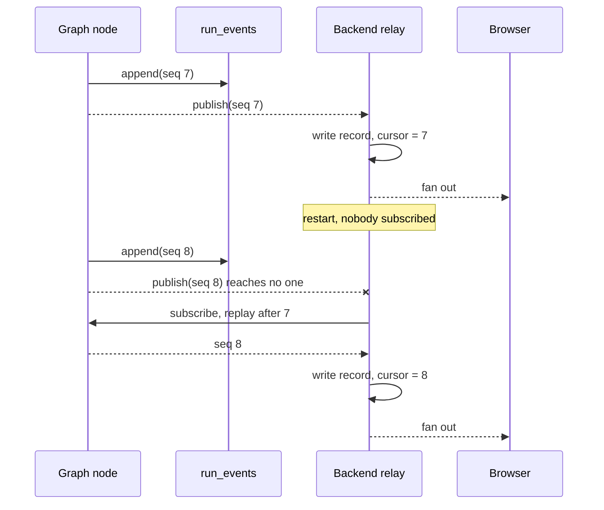

> **TL;DR** The backend talks to the agent over one persistent WebSocket, not a queue and not HTTP, because the traffic is many small events flowing one way during a single long operation, and because the channel is a generated contract. A node deep in a subgraph emits by calling one function; it never sees a socket. The part that is easy to get wrong is durability: a broadcast reaches whoever is listening _at the time_, so every event a reconnect would need is appended to Postgres before it is published, and a reconnecting subscriber asks for everything after the sequence it last handled.

[Part 7](/posts/agent-graph-engineering/a-run-that-stops-for-a-person/) left a run stopped, waiting for a human. This post is about how anyone found out it was waiting.

## Table of contents

## Three ways to move progress, and why one wins here

The agent takes seconds to tens of seconds per run and produces a stream of small events along the way: the ticket was classified, a decision was made, a tool is being proposed, here is the reply arriving a few words at a time. Something has to carry those to a browser.

Polling is the one you reach for because it needs no new infrastructure. It also means picking an interval, and every interval is wrong. Poll every two seconds and a token stream arrives in lumps; poll faster and you are hammering a database to be told nothing changed. For output that is genuinely continuous, polling turns a stream back into a slideshow.

A queue is the serious alternative, and its strengths are real: durability, fan-out to multiple consumers, retries, and work that survives the consumer being absent entirely. I would not give those up lightly.

They are mostly not the properties this path needs. The backend is one consumer, it is present for the duration, and the events are only interesting while a human is watching. Meanwhile a queue costs you a broker to operate, per-message overhead on traffic that is many small messages, and no natural way to send something _back_, which matters because approving a tool call is a message going the other way. You end up with two queues and a correlation id, reimplementing a connection.

A persistent socket fits the shape. Bidirectional, so a decision travels the same path as the progress. Negligible per-message cost once established, which suits token-level output. Liveness for free, since a dropped connection is an event rather than a timeout you infer. And backpressure is the transport's problem rather than yours.

So a queue wins when work must survive the consumer being gone. A socket wins when two parties are both present for one long operation and need to talk. For driving a live agent run, that is the socket.

There is a fourth reason, and for me it is the decisive one: the socket is a generated contract. [Part 3](/posts/agent-graph-engineering/contracts-not-conventions/) covered this. The agent's channel produces an AsyncAPI document, and the backend imports a generated Python client from it. A queue topic is a string and a payload you both hope about. That is a convention. I have debugged a convention.

## One connection, many runs

The agent exposes a single channel and the backend holds one socket to it:

```python
@channel(
    name="agent",
    description="One connection from the backend, many runs",
    tags=["agent"],
)
class AgentHubConsumer(AsyncJsonWebsocketConsumer):
    """The backend's single socket into this service.

    One connection rather than one per run: a run belongs to its ticket or
    conversation, so a resume arrives on a subscription that is already open and
    a node can emit without the socket that started the run being the only thing
    that can hear it.
    """
```

A connection per run is the obvious first design, and it couples the run's lifetime to a socket's lifetime. When the approval arrives twenty minutes later it starts a new run on the same thread, and that run is addressed by its _topic_, not by whichever socket happened to start the last one.

Topics are how one connection carries many things. Each ticket's conversation is a topic, one for the customer and one for the team, addressed per frame, and the browser side works the same way, so a browser watching four tickets holds one socket rather than four. And publishing needs no consumer instance at all, because broadcast is a classmethod. That last detail is what makes a background task able to drive a run and still reach the right audience.

## Emitting from anywhere

Here is the thing I wanted for years and never built. A node deep inside a subgraph needs to tell the user it decided something. It does this:

```python
async def answered(self, ticket_id: str, answer: TicketAnswer) -> None:
    await self.emit(
        AnswerMessage(
            payload=AnswerPayload(
                ticket_id=ticket_id,
                content=answer.content,
                model=self.answer_model,
            )
        )
    )
```

`self.emit`. That is the entire surface. There is no socket to pass, and no stream handle threaded down through four signatures so the leaf can reach the transport. The node constructs a typed message and hands it over.

The alternative, passing a writer down the call graph, infects every signature between the entry point and the leaf. Every function that merely forwards it now mentions transport, so a graph node's type depends on how its output eventually reaches a browser. Reuse dies, and testing a node means constructing a fake socket.

With broadcast-from-anywhere, a node's dependency is a function that takes a message. In tests that is a list append.

This is also the specific gap that made me reach outside LangGraph. LangGraph can stream, but for anything that is not a LangChain object it offers a generic custom channel, so you end up inventing your own envelope and your own dispatch. The typed-message library already had both.

## Streaming tokens without a client that drifts

Token-level output looks like the easy part. Deltas arrive, you forward each one, the browser appends them. It works immediately in a demo and it is wrong in two ways.

A browser that accumulates loses everything on reconnect. If the client holds the partial text and the socket drops, the text is gone, and the reconnecting client has no way to ask for "the bit I had so far" because nobody else ever had it.

Appending is not idempotent. A page builds its timeline from a page load and a live feed at once, and it subscribes before the fetch resolves. So an event arriving in that window renders twice, and a snapshot taken a moment earlier drops it. At-most-once delivery on the server does not make the client idempotent.

So accumulation happens on the server, and it happens one hop later than you might expect. The agent forwards raw deltas to the backend, which is cheap on a single internal connection. The backend builds up the reply as they arrive and broadcasts the whole of it so far to browsers, with a stable reference id, and the client upserts by that id rather than concatenating. Reconnect mid-stream and the next broadcast carries the full text, so the client self-heals. Render the same event twice and the second render replaces the first instead of doubling it.

That is a few more bytes per frame in exchange for a client that cannot drift.

## Durability, or the reply nobody was listening for

The failure here is invisible, and the module that prevents it says why in its docstring:

> A broadcast reaches whoever is listening at the time, so a restart mid-run leaves the run recoverable and the record empty.

The agent restarts while a run is in flight. The run itself is fine, because [Part 7](/posts/agent-graph-engineering/a-run-that-stops-for-a-person/) put its state somewhere the agent restarting cannot touch, so it carries on and finishes correctly. But the events it published while nobody was subscribed went nowhere. The reply was generated. The reply was sent. The customer never saw it, and the ticket log does not show it, because the backend learns what happened by being told and it was not listening when it was told.

So the run is correct and its outcome is lost, and nothing in any log says a thing went missing, because from each component's point of view nothing failed.

The fix has three parts.

**Append before publishing.** Every event a reconnect would need goes into Postgres first, with a sequence number, then gets broadcast:

```sql
CREATE TABLE IF NOT EXISTS run_events (
    run_key    TEXT NOT NULL,
    seq        BIGINT NOT NULL,
    action     TEXT NOT NULL,
    event      JSONB NOT NULL,
    created_at TIMESTAMPTZ NOT NULL DEFAULT now(),
    PRIMARY KEY (run_key, seq)
)
```

As the class puts it: Postgres-backed, so what a run said outlives the process that said it. Token and reasoning deltas are the one thing left out, because the finished answer arrives as an event of its own and replaying a thousand deltas would only redraw it.

**A cursor on the consumer.** The backend records the last sequence whose effect is durable, meaning written down, not merely received. On subscribe it asks for everything after that.

**Replay on request, to one connection.** The agent answers with what the run already said, sent to the asking connection rather than broadcast, so a reconnect does not replay someone else's screen.

In order, with a restart in the middle of it:



Sequence 8 was published to an empty room, and the cursor is what gets it back.

Two details make it safe. A replay starts strictly _after_ the cursor, which stops an event being applied twice. And for the one event that is not safe to apply twice, a reply sent to a customer, the cursor advances in the same transaction as the row that records it, so a crash between the two cannot send it again. Every other event is idempotent, so its cursor simply moves afterwards. Get either detail wrong and you have swapped lost messages for duplicated ones, which for a customer-facing reply is not an improvement.

## What it costs

A socket is stateful, and stateful things complicate deploys. Rolling a worker drops connections. Clients reconnect and replay, which is exactly why replay exists, but you have to build it before you need it.

You need a channel layer. Broadcast across processes means Redis here. That is infrastructure a plain HTTP service does not have.

Ordering is per topic, not global. Fine for this, since each ticket's conversation is a topic and its events are ordered. Do not assume more than that.

Replay is unbounded. Nothing prunes `run_events`. A retention policy is still owed.

The agent must stay internal. The approval gate lives inside the graph, so anything that can open this socket can both propose a tool call and approve it. Network isolation is the real control and the shared token is the second line. It is unset in a fresh clone so the thing runs, which means it is also unset if you forget.

## What the socket does not do

It does not drive the run. If the run is a task in whichever web process took the request, the socket's lifetime and the run's tangle together, and a deploy ends both. Here the request puts a job on a queue and returns, a worker drives the run, and the socket is only how the two services talk while it happens. The case for that split gets its own space in the part on shipping.

Next is the practices post: concrete patterns on both sides of the boundary, the Django service and the agent service, which is the one most likely to be useful if you are adapting this rather than reading it. Hope this one helps, particularly the append-before-publish part, which is the one I would build before any of the others.

I write these deep-dives and maintain a handful of Python libraries, so if that is your kind of thing, follow along on [GitHub](https://github.com/huynguyengl99) and [LinkedIn](https://www.linkedin.com/in/huynguyengl99/).
