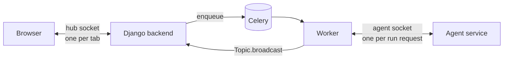
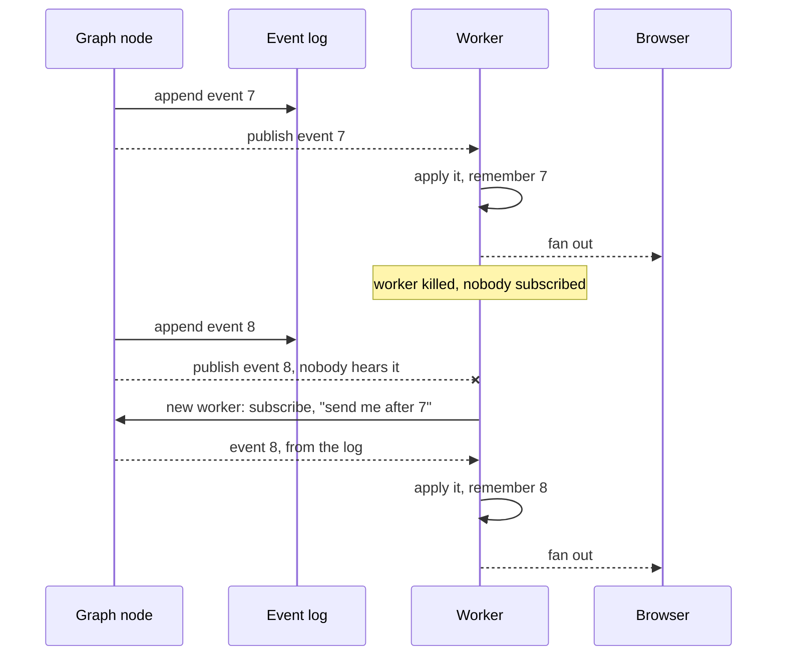

> **TL;DR** Start with Server-Sent Events. If you are streaming one answer into one page, SSE is simpler and you should use it. This system outgrew it on the browser side, where a support rep watches several tickets, acts on them, and needs to see some events the customer must not, all over one authenticated connection. Both hops use [chanx](https://github.com/huynguyengl99/chanx) for typed messages and topics, and both are described by AsyncAPI, so the backend's Python client and the browser's TypeScript client are generated. A node emits a typed message by calling one function and never sees a socket. Pydantic AI produces the deltas and LangGraph runs the nodes, but neither one does the delivery. The part that is easy to get wrong is the reply nobody was listening for. A broadcast only reaches whoever is subscribed at that moment, so every event that matters goes into a numbered log first, and a new connection starts by asking what it missed.

[Part 7](/posts/agent-graph-engineering/a-run-that-stops-for-a-person/) left a run stopped, waiting for a human. This post is about how anyone found out it was waiting, and how everything else a run says reaches a browser while it says it.

## Table of contents

## Two hops, and what crosses each

There are two connections here, not one. That is the first thing to be clear on, because "the WebSocket" in this system means two different sockets with different jobs.



The browser holds one socket to the Django backend for as long as the tab is open. Over it the browser subscribes to tickets, sends a message, asks the agent something, changes a ticket's status, approves a draft, corrects a tool call. Back over it come new ticket events, the reply as it is written, the agent's reasoning, progress, and the approval cards.

A run is driven by a Celery worker, not by the web process that took the request. The worker opens a socket to the agent, subscribes to the run's topic, sends the request, applies each event as it arrives, and closes when the agent says the run has ended. If the run stopped for a person, the decision later starts a fresh connection with the saved state in the request, which is the design from part 7.

The agent's consumer could carry many runs on one connection, and its docstring says so. The backend does not use it that way today. One connection per run request turned out simpler, because a run's lifetime and its worker's lifetime are already the same thing. I mention it because an earlier version of this post claimed a single persistent backend socket, and that was not what the code does.

## SSE first, because it is usually the right answer

If you are building this from scratch, the first transport to consider is Server-Sent Events, not a WebSocket. It is what the LLM providers use for their own streaming APIs, and for good reasons.

It is plain HTTP. Your load balancer, your auth cookies, your logging and your proxies already understand it. The browser's `EventSource` reconnects on its own. And it has resumption built into the protocol: each event can carry an id, and a reconnecting client sends `Last-Event-ID` so the server can continue from there. Remember that one, because later in this post I build the same thing by hand.

So if what you need is "stream one answer into one page", use SSE and send user actions as ordinary POST requests. That is a good design and I would not talk anyone out of it.

It stopped fitting here, on the browser side, for three reasons.

The traffic goes both ways, constantly. A rep sends messages, asks the agent, updates a ticket, approves drafts and corrects tool calls. With SSE each of those is a POST, which works, but now one feature has two transports. The actions are described by OpenAPI and the stream by nothing standard, so the event types the browser handles are a convention again. [Part 3](/posts/agent-graph-engineering/contracts-not-conventions/) was about getting rid of exactly that.

One tab watches several things. A rep has a ticket list, an open ticket, and the team's half of that ticket, which carries events the customer must never see. With one SSE stream per ticket you run into the browser's limit of six connections per origin over HTTP/1.1, unless everything in front of you speaks HTTP/2. With one stream for everything, you are filtering on the server and deciding per event who may see it. That is a subscription system, and you are now writing it yourself.

Authorization is per subscription. The customer's topic and the team's topic are about the same ticket, and only staff may join the second. That check belongs at the moment a connection joins a topic, once, not on every event pushed down a shared stream. `EventSource` also cannot set headers, so the stream's auth has to come from a cookie or a token in the URL.

On the agent hop SSE comes closest, and I want to be straight about that. A `POST /runs` that streams events back would carry most of what crosses it. What tipped it was that a run's conversation is three messages on one connection: subscribe to the topic, ask for anything missed since a sequence number, then send the request, with the catch-up and the live events arriving interleaved on the way back. That fits a socket better. The bigger reason is that both hops then use the same library, the same message model and the same contract tooling. With two transports, every idea in this post would need explaining twice.

For completeness, polling and a queue. Polling turns a token stream into a slideshow, because every interval is wrong. Poll slowly and the reply arrives in lumps. Poll fast and you hammer a database to be told nothing changed. A queue does sit in this design, Celery, and its job is to make sure the run gets driven even if the web process that took the request goes away. It is the wrong tool for the live events, because those are only interesting while someone is watching, and a queue has no natural way to talk back to the client.

## What chanx does on each side

Disclosure first: I wrote chanx. I wrote it because I kept rebuilding these same pieces on every project that needed a socket.

It runs on Django Channels and on FastAPI with the same API, and this repo uses it on both. Here is what it does for this system.

Messages are typed. Every message is a Pydantic model with an `action` literal, and that literal is what the framework dispatches on:

```python
class ChatTokenMessage(BaseMessage):
    """One delta of the answer, forwarded as the graph produces it."""

    action: Literal["chat_token"] = "chat_token"
    payload: ChatTokenPayload
    # One piece of something still being written. Live only: a
    # replay of half a sentence is worse than not replaying it.
    replayable: ClassVar[bool] = False
```

A handler is a method decorated with `@ws_handler`, and its argument's type says which message it handles. A frame that does not validate is rejected before it reaches your handler.

Topics make one connection carry many subscriptions. A topic is a class with an address pattern and an authorization check:

```python
class TicketTeamTopic(Topic[...]):
    pattern = "ticket:{ticket_id}:team"

    async def authorize(self, **params: str) -> bool:
        user = self.scope.get("user")
        if not (user is not None and getattr(user, "is_staff", False)):
            return False
        return bool(await self._ticket_exists(params["ticket_id"]))
```

The browser joins `ticket:42` and, if it is staff, `ticket:42:team`, over the same socket, and the server decides at join time. Visibility is decided at the subscription rather than by filtering every event, so an event published to the team topic cannot reach a customer, because no customer connection is subscribed to it.

Broadcasting needs no connection. `Topic.broadcast` is a classmethod that goes through the channel layer, which is Redis here, so a Celery worker that holds no browser connection at all can push to everyone watching a ticket. That is how the worker relays a run's events to browsers.

Frames carry an envelope. Next to the message, each frame can carry its `topic`, a `ref` that ties a reply to the request that caused it, and a `seq` for ordering and catch-up. The backend uses `ref` to tell a catch-up apart from live events, and `seq` to know where it got to. Both come up again in the durability section.

Auth reuses what the REST API already has. The browser socket authenticates with DRF's own permission classes, so one identity covers both:

```python
class HubAuthenticator(DjangoAuthenticator):
    permission_classes = [IsAuthenticated]
```

## What AsyncAPI does

AsyncAPI is to message-based APIs what OpenAPI is to REST: a machine-readable document that lists the channels, the messages each side may send, and their schemas. chanx generates it from the decorated consumers and the message types, so nobody writes it.

Part 3 covered the contract story in depth. On the streaming path specifically, it works out like this.

The agent serves `/asyncapi.json`. `just gen-agent-client` runs `chanx generate-client` against it, and the backend gets a typed Python client: a class per topic, and a message class for every event the agent can send. The relay that applies a run's events is a `match` over those generated classes. Rename a field on the agent, regenerate, and the type checker points at the relay line that still uses the old name.

The backend serves its own document, and `pnpm gen:ws` turns it into TypeScript. The browser's subscription is then typed end to end:

```ts
const { send } = useTopic(hub, hub.topics.ticketTopic.with({ ticket_id: ticketId }), {
  on: {
    new_event: (message) => onNewEvent?.(message.payload.event),
    answer_streaming: (message) =>
      onAnswer?.(message.payload.reference, message.payload.content),
  },
});
```

Each handler's `message` is narrowed by its action, and `send` only accepts actions the server declares for that topic. A typo in an action name is a compile error, not a silent no-op.

The same document is also browsable at `/asyncapi`, which makes it the docs page for every event the agent can emit. When someone asks what the frontend can expect during a run, that page is the answer, and it cannot be out of date.

## How it fits with Pydantic AI and LangGraph

Three pieces do separate jobs here, and it helps to keep them apart. Pydantic AI produces the deltas. LangGraph runs the nodes. chanx delivers what the nodes say.

### Pydantic AI produces the deltas

An agent step runs with `run_stream`, and `stream_output` yields partial structured outputs as the model writes them. Each partial carries the whole field so far, not the new piece, so the step diffs them:

```python
async with self.agent.run_stream(prompt, deps=deps, message_history=history) as result:
    async for partial in result.stream_output(debounce_by=settings.stream_debounce):
        if content := str(getattr(partial, "content", "") or ""):
            if delta := content[len(written):]:
                await on_delta(delta, ANSWER)
                written = content
```

This streams a typed output, not raw text, so a step that returns a `TicketAnswer` still streams its `content` field while the rest of the object fills in. The cost is real and the code says so in its docstring. `run_stream` cannot ask the model to fix an output that fails validation, while `run` can. So a validation failure ends the streaming, not the step: it falls back to a plain `run`, and the user sees the answer arrive whole instead of word by word.

The `on_delta` callback wraps each piece in a typed message, `ChatTokenMessage` for answers and `ReasoningDeltaMessage` for reasoning, and emits it.

### LangGraph runs the nodes, and has its own way to stream

LangGraph has stream modes, and two matter here. `messages` streams tokens from LangChain chat models. A Pydantic AI call is not one, so for this repo that mode is silent. `custom` streams anything a node writes with `get_stream_writer()`:

```python
from langgraph.config import get_stream_writer

def node(state):
    write = get_stream_writer()
    write({"step": "classified", "category": "billing"})
```

To be fair to it, the writer is found through a context variable, so nothing has to be threaded through function signatures. An earlier version of this post said otherwise. If your graph is built on LangChain models and one process both runs the graph and talks to the client, this is the natural tool.

Two things made it the wrong fit here.

Everything written comes back out of the single `astream` loop that started the run. That loop then has to work out what each dict is, who may see it, whether it needs persisting, and where to send it. It becomes a dispatcher with your own envelope format, and the events are untyped dicts until it says otherwise.

Some events do not come from a node at all. "The run ended, here is its state" and "the run failed" are published by the code around the graph, so they would need a second path anyway.

### So a node is handed a function

The graph is constructed with the topic's `publish` method, and a node calls it:

```python
async def answered(self, ticket_id: str, answer: TicketAnswer) -> None:
    await self.emit(
        AnswerMessage(
            payload=AnswerPayload(
                ticket_id=ticket_id,
                content=answer.content,
                model=self.answer_model,
            )
        )
    )
```

`self.emit` takes one typed message, and that is the whole surface. The message is already in the AsyncAPI contract. `publish` writes it to the run's event log and broadcasts it to the topic, so it reaches whoever is subscribed straight from wherever it was said: a node three subgraphs deep, the delta callback inside a model call, or the handler reporting that the run failed.

That leaves the `astream` loop with almost nothing to do. It only has to drain the graph for the state the run ended with:

```python
stream: Any = graph.astream(start, config=config, stream_mode="values")
final: dict[str, Any] = {}
async for chunk in stream:
    if isinstance(chunk, dict):
        final = chunk
return final
```

In tests, `emit` defaults to a function that does nothing, or a test passes a list's append. No socket, no fake transport.

## Streaming tokens without a client that drifts

Token-level output looks like the easy part. Deltas arrive, you forward each one, the browser appends them. It works right away in a demo, and it is wrong in two ways.

A browser that accumulates loses everything on reconnect. If only the client holds the partial text and the socket drops, the text is gone, and the reconnected client cannot ask for "the bit I had so far", because nobody else ever had it.

Appending is not idempotent either. A page builds its timeline from a page load and a live feed at once, and it subscribes before the fetch resolves. An event that arrives in that window renders twice, and a snapshot taken a moment earlier drops it.

So accumulation happens on the server, one hop later than you might expect. The agent forwards raw deltas to the worker, which is cheap on one internal connection. The worker adds each delta to the reply so far and broadcasts the whole of it to browsers, with a stable reference id:

```python
async def token(self, delta: str) -> None:
    """One more piece of the reply, published as the whole of it so far."""
    if not self.answer_reference:
        self.answer_reference = str(uuid4())
    self.answer += delta
    await broadcast(
        self.ticket_id,
        AnswerStreamingMessage(
            payload=AnswerStreamingPayload(
                reference=self.answer_reference,
                content=self.answer,
                public=self.visibility == Visibility.PUBLIC,
            )
        ),
    )
```

The client replaces by reference instead of appending. Reconnect mid-stream and the next frame carries the full text, so the client fixes itself. Render the same frame twice and the second replaces the first. It costs a few more bytes per frame, and in exchange the client cannot drift.

## The reply nobody was listening for

This is the failure I most want you to avoid, because when it happens nothing looks broken.

Here is how it goes. A worker is driving a run, and halfway through it gets killed. A deploy, a memory limit, it does not matter which. Its socket to the agent closes.

The agent does not stop. chanx runs each handler as its own task, so the graph keeps going after the connection is gone. It finishes the reply and publishes "reply sent" to the run's topic.

A broadcast goes to whoever is subscribed at that moment, and right now that is nobody. The event is gone.

Celery hands the task to another worker, which connects, subscribes, and carries on. But the reply that was already written never reaches the backend, so it never becomes a ticket event, and the customer never sees it. Every component did its job, and no log line says anything went missing.

The fix works like the unread marker in a chat app. The agent keeps a numbered log of everything each run said. The backend remembers the last number it acted on. And every new connection opens by saying "I am at 7, send me what I missed" before it asks for anything new.



In code, that is three pieces.

The agent appends before it publishes. `publish` does both in one call, so an event cannot reach a browser while missing from the log. The log is a Postgres table keyed on the run and a sequence number the database assigns:

```sql
CREATE TABLE IF NOT EXISTS run_events (
    run_key    TEXT NOT NULL,
    seq        BIGINT NOT NULL,
    action     TEXT NOT NULL,
    event      JSONB NOT NULL,
    created_at TIMESTAMPTZ NOT NULL DEFAULT now(),
    PRIMARY KEY (run_key, seq)
)
```

Token and reasoning deltas are left out, which is the `replayable = False` on the message class above. The finished answer arrives as an event of its own, so replaying a thousand deltas would only redraw it.

The backend keeps a cursor per run: the last sequence number whose effect is written down. Not merely received, written down.

A new connection asks for what it missed. The worker subscribes first, then sends a replay request from its cursor, then sends the actual request. The agent answers the replay on that one connection, not as a broadcast, so a catch-up never lands on anyone else's screen.

Two details decide whether this is safe or just moves the bug around.

Replay starts strictly after the cursor, so nothing is applied twice. And for the one event that is not safe to apply twice, a reply going to a customer, the cursor moves in the same database transaction as the row that records the reply. If the worker crashes between the two, neither happened, and the replay delivers it once. Every other event is idempotent, so its cursor simply moves after it is applied. Get either detail wrong and you have traded lost messages for duplicated ones, which for a reply to a customer is no better.

This is the same idea as SSE's `Last-Event-ID`, built by hand. The protocol part is the easy half either way. The real work is keeping the log, and you would have to build that with SSE too.

## Practices worth copying

These are the ones I would keep on any project, socket or not.

- **Subscribe before you send the request.** Otherwise the run's first events race the subscription and are dropped. The worker's opening sequence is subscribe, replay, request, in that order, and there is a comment saying why.
- **Accumulate on the server, replace on the client.** Send the whole thing so far with a stable id, never a delta for the browser to stitch.
- **Append before you publish.** One call does both, so the log cannot lag the broadcast.
- **Move the cursor before you close.** Close the socket on the final event first and the advance is lost, so the last event goes unrecorded and the next run on that topic replays it.
- **Decide visibility at the join.** Two topics for two audiences, authorized when a connection subscribes, rather than one topic filtered per event.
- **Log what the generated client swallows.** The generated defaults print invalid frames to stdout and drop connection errors. Both are overridden here to log properly, because a run that dies in silence leaves nothing behind.
- **Keep the agent internal.** Anything that can open the agent socket can propose a tool call and approve it. Network isolation is the real control and the shared token is the second line.

## What it costs

A socket is stateful, and stateful things complicate deploys. Rolling a process drops its connections. Clients reconnect and catch up, which is exactly why catch-up exists, but you have to build it before you need it.

You need a channel layer. Broadcasting across processes means Redis. A plain HTTP service does not need that.

Your infrastructure has to allow it. Load balancers need upgrade headers and sensible idle timeouts, and HTTP middleware does not see what happens inside a socket. SSE gets all of that for free.

You rebuild request and response. A frame has no status code and no built-in correlation. chanx's `ref` covers the correlation, but you think about it in a way you never do with HTTP.

Ordering is per topic, not global. That is fine here, because each run is a topic and its events arrive in order. Do not assume more than that.

The log grows without limit. Nothing prunes `run_events` yet. A retention policy is still owed.

The token is off by default. It is unset in a fresh clone so the thing runs, which also means it is unset if you forget.

Next is [the practices post](/posts/agent-graph-engineering/practices-for-both-services/): concrete patterns on both sides of the boundary, the Django service and the agent service. Hope this one helps. If you only build one thing from it, make it the event log with a cursor, because without it the failure is silent. And if you made SSE work for a multi-ticket UI, feel free to share how you handled the subscriptions.

I write these deep-dives and maintain a handful of Python libraries, so if that is your kind of thing, follow along on [GitHub](https://github.com/huynguyengl99) and [LinkedIn](https://www.linkedin.com/in/huynguyengl99/).
